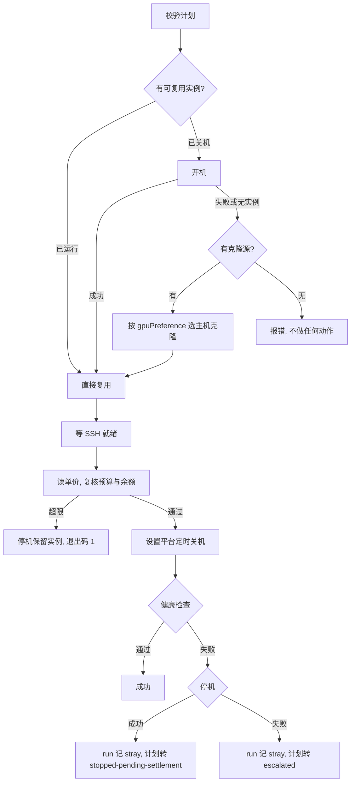

# deploydeck 操作手册

本文供外部项目的人员与 agent 使用。读完本文即可操作 deploydeck，不需要读 deploydeck 源码。

本文只写「怎么用」。命令参数的精确形状、`--json` 字段与退出码逐条说明见
[CLI 命令面](cli.md)。本文是该文档的操作版：先做什么、后做什么、每步判据是什么。

## 1. 这个工具做什么

deploydeck 是一个部署工具箱，不是全自动部署器。它只负责两件事：操作机器，以及提供自动连接到部署机的 TTY。

凡是动态行为——装环境、拉代码、起服务、排查——全部由使用者自己决定和执行。全自动不是本工具的性质：要全自动，由 agent 操作这个工具箱来实现，agent 能判断某条命令成没成、要不要重连、下一步做什么。

它把一次云端实例获取收敛成一条链路：

```text
申请计划 → 获取实例 → 等 SSH 就绪 → 健康检查 → 结束
```

三件事由它保证：

1. 没有计划不得开机或克隆。计划写明可用时长与预算上限。
2. 实例到手后自动设置平台定时关机。到点平台关停实例，不依赖 deploydeck 进程存活。
3. 每一步留日志与账本。实例销毁后，现场仍在本机。

装环境、拉代码、起服务不在链路里。它们由使用者自己在实例上执行，见 §2.4。

判据：`run` 成功只保证「实例已获取、已连通、健康检查通过」。它不保证业务服务可用。

deploydeck 不构建镜像、不管本地部署、不替代 AutoDL 控制台。

### 1.1 六个名词

| 名词 | 一句话含义 |
|---|---|
| 部署配置（Profile） | 一个场景怎么取实例：实例名、算力规格优先级、开机形态、时长、预算、失败策略 |
| 项目清单（Project） | 实例内目录与健康检查命令 |
| 计划（Plan） | 一次授权窗口：能用多久、最多花多少 |
| 执行（Run） | 计划下的一次实例获取动作，含逐步日志 |
| 实例 | AutoDL 控制台里的一台容器实例 |
| 账本 | 一行一个实例生命周期：规格、起止时刻、单价、金额 |

完整术语见 [术语表](../GLOSSARY.md)。

## 2. 外部项目接入：准备两个文件

deploydeck 不认识任何具体项目。接入一个项目只需在配置目录放两个 JSONC 文件。
被部署的仓库里不需要放任何脚本。

### 2.1 配置目录

| 目录 | 默认位置 | 谁写 |
|---|---|---|
| 配置目录 | `~/.config/deploydeck` | **人写，机器只读** |
| 状态目录 | `~/.local/state/deploydeck` | 机器写 |

```text
<配置目录>/
├── projects/<projectId>.jsonc    项目清单，一个项目一份
└── profiles/<profileId>.jsonc    部署配置，一个场景一份
```

判据：deploydeck 不会改写配置目录里的文件。状态目录不得放在配置目录内。

### 2.2 项目清单 `projects/<id>.jsonc`

它随被部署的项目走，不进 deploydeck 仓库。

| 字段 | 必填 | 含义 |
|---|---|---|
| `id` | 是 | 项目标识。文件名去掉 `.jsonc` 必须等于它 |
| `workdir` | 是 | 实例内的项目目录，例如 `/root/my-project`。健康检查命令在它里面执行 |
| `healthCheck` | 是 | 健康检查命令。退出码 0 即通过 |

```jsonc
{
  "id": "my-project",
  "workdir": "/root/my-project",
  "healthCheck": "curl -fsS http://127.0.0.1:6006/health"
}
```

判据：

1. `workdir` 必须是绝对路径，且不能以 `/` 结尾。含双引号或换行的取值在生成步骤时即报错。
2. 引擎把健康检查拼成 `cd "<workdir>" && <healthCheck>` 执行。引号里的 `~` 不展开，所以不用相对路径。
3. `healthCheck` 不能为空。它必须能在实例内跑通。
4. 服务没有健康端点时，改用该服务确实可用的探活命令。否则 `run` 会以健康检查失败告终。

### 2.3 部署配置 `profiles/<id>.jsonc`

它规定某个场景怎么取实例。开发与生产的差别全部写在这里，引擎不按「开发/生产」分支判断。

| 字段 | 必填 | 含义 |
|---|---|---|
| `id` | 是 | 配置标识。文件名去掉 `.jsonc` 必须等于它 |
| `project` | 是 | 引用项目清单的 `id` |
| `provider` | 否 | 控制面实现，缺省 `autodl`。当前只接入了 `autodl` |
| `instanceNamePattern` | 是 | 实例名。控制台已有同名实例时复用它，没有时用它创建 |
| `gpuPreference` | 是 | 算力规格优先级，左端最高。克隆时按它选主机，不跳档 |
| `regionPreference` | 否 | 地区优先级，空数组表示不限制 |
| `powerOnMode` | 否 | 开机形态：`gpu`（缺省）或 `no-gpu` |
| `cloneDataDisk` | 否 | 克隆时是否一起拷贝数据盘，缺省 `true` |
| `cloneSourceInstanceName` | 否 | 克隆源实例的名字或 ID。走克隆路径时必须有 |
| `ttlMinutes` | 是 | 计划默认可用分钟数 |
| `budgetCapYuan` | 是 | 计划默认预算上限，单位元 |
| `onDeployFailure` | 否 | `keep-container`（缺省值）或 `destroy-container` |

```jsonc
{
  "id": "my-project-dev",
  "project": "my-project",
  "provider": "autodl",
  "instanceNamePattern": "my-project-dev",
  "gpuPreference": ["v-32g-p", "5090-p"],
  "regionPreference": [],
  "powerOnMode": "no-gpu",
  "cloneDataDisk": true,
  "cloneSourceInstanceName": "my-project-dev",
  "ttlMinutes": 60,
  "budgetCapYuan": 6,
  "onDeployFailure": "keep-container"
}
```

`gpuPreference` 的取值可以是 AutoDL 的算力规格 id，也可以是选主机页显示的型号名。
已收录的 id：

| 规格 id | 选主机页显示名 |
|---|---|
| `v-48g` | vGPU-48GB |
| `v-32g-p` | vGPU-32GB |
| `5090-p` | RTX 5090 |
| `pro6000-p` | RTX PRO 6000 |
| `v-48g-350w` | vGPU-48GB-350W |
| `h800` | H800 |
| `4090D` | RTX 4090D |

表外取值原样当作页面型号名匹配。匹配失败时 deploydeck 报错并列出页面可选型号，不猜。

### 2.3.1 `powerOnMode`：开发测试用无卡，需要算力才用有卡

| 取值 | 行为 | 代价 |
|---|---|---|
| `gpu` | 租用算力开机。主机没有空闲 GPU 时开不了机，引擎改走克隆 | 贵 |
| `no-gpu` | 无卡模式开机。不占 GPU，主机没有空闲 GPU 也能开机 | 便宜，几乎可忽略 |

判据：

1. **开发与测试环境写 `no-gpu`。** 无卡模式几乎不花钱，且不会因为主机没卡而失败。
2. **真的需要算力时才写 `gpu`。** 例如要在容器里跑模型。
3. 引擎不会自行降级到无卡模式，也不会从无卡模式升到有卡模式。写什么就做什么。
4. 实例已经以有卡形态运行时，`run` 不会为了走无卡模式去关机重开。它报错要人决定。

要在一台已有实例上换形态，用 `deploydeck switch <instanceId> --gpu|--no-gpu`。

### 2.3.2 `onDeployFailure`：部署失败后容器怎么办

`onDeployFailure` 只管容器，不管代码。

| 取值 | 部署失败后 |
|---|---|
| `keep-container` | 容器保留，实例停机。人可进去查现场。到计划过期时由 `guard` 销毁。 |
| `destroy-container` | 当前与 `keep-container` 行为相同：保留容器并停机，不自动销毁。 |

判据：自动判定失败只停机止损，不销毁容器。销毁入口只有 `teardown` 命令一条。

### 2.4 哪些事引擎不做

`run` 只做三件事：获取实例（开机复用或克隆）、等 SSH 就绪、健康检查。
它不碰实例里的代码与环境。

判据：装环境、拉代码、起服务都不由引擎执行。引擎里没有对应的字段，也没有对应的步骤。

| 这件事 | 谁做 | 入口 |
|---|---|---|
| 装环境（系统包、语言运行时、Python/Node 依赖） | 使用者 | `shell -- '<命令>'` 或 `shell <instanceId>` 交互终端 |
| 拉代码、切版本、构建产物 | 使用者 | 同上 |
| 起服务、改配置、导入数据 | 使用者 | 同上 |

推荐顺序：

1. 执行 `deploydeck run --plan <planId>`，确认退出码 0。此时实例已开机、SSH 已连通。
2. 执行自己的环境准备与启动命令。
3. 执行自己的验证命令，确认业务服务真的可用。
4. 收工执行 `deploydeck teardown <planId>`。

单条命令形态：

```bash
deploydeck shell <instanceId> -- '<命令>'
```

例：

```bash
# 拉代码并切到指定版本
deploydeck shell <instanceId> -- 'cd /root/my-project && git fetch && git checkout -f <sha>'

# 装依赖
deploydeck shell <instanceId> -- 'cd /root/my-project && npm ci'
```

判据：

1. 命令用登录 shell 执行（远端收到的是 `bash -lc '<原文>'`），环境与交互终端里一致。
2. 一条命令的超时是 600 秒。超过它会以 `SHELL_FAILED` 失败，退出码 2。
3. 装环境与下载模型这类长任务的耗时由数据量与网络决定。用交互终端跑，自己判断卡住要不要中断。
4. 使用者自己保证脚本幂等：同一台实例可能被重复获取，也可能被人中途接管。
5. 业务服务是否就绪，用使用者自己的判据确认。`run` 的成功信号不覆盖这一层。

### 2.5 接入检查清单

1. 配置目录里放好 `projects/<id>.jsonc` 与 `profiles/<id>.jsonc`。
2. 项目清单的 `workdir` 在被部署的实例里真实存在，取值是绝对路径、不以 `/` 结尾。
3. 项目清单的 `healthCheck` 已经在这台实例的 `workdir` 里手工跑通过，退出码 0。
4. 控制台里有一台**已关机**实例，名字或 ID 等于 `cloneSourceInstanceName`。它是克隆模板。
5. 环境准备与启动命令已经写好在实例上能跑通的形态，接入时经 `shell --` 执行。
6. 执行 `deploydeck profile list`，确认配置能被解析。

`profile list` 会一次报完全部配置问题。配置有错时不做任何控制台动作。

## 3. 构建与安装

deploydeck 当前不发 npm 包。从源码构建：

```bash
git clone https://github.com/ZQH123196/deploydeck.git
cd deploydeck
pnpm install
pnpm build
node dist/cli/main.js --help
```

要求 Node.js 22 或更高。

下文命令里的 `deploydeck` 有两种写法，任选其一：

```bash
# 写法一：直接调构建产物
node /path/to/deploydeck/dist/cli/main.js status

# 写法二：起一个别名
alias deploydeck='node /path/to/deploydeck/dist/cli/main.js'
```

## 4. 首次使用

### 4.1 登录控制台

```bash
deploydeck login
```

它会启动一个**专用 Chrome**，打开 AutoDL 控制台，等人登录。登录完成后命令返回。

判据：

1. 专用 Chrome 使用独立 user-data-dir，与日常浏览互不干扰。
2. deploydeck 不填账号密码。登录只由人完成。
3. 默认等待 300 秒，超时退出码 2。可用 `--timeout <秒>` 改。

登录态保存在专用 Chrome 中。需要重新登录时，再跑一次 `deploydeck login`。

### 4.2 环境变量

全部环境变量只在这几处生效。不需要的一律不用配。

| 变量 | 默认值 | 用途 | 哪些命令需要 |
|---|---|---|---|
| `DEPLOYDECK_CONFIG_DIR` | `~/.config/deploydeck` | 配置目录 | 全部 |
| `DEPLOYDECK_STATE_DIR` | `~/.local/state/deploydeck` | 状态目录 | 全部 |
| `DEPLOYDECK_CDP_PORT` | `9222` | 专用 Chrome 的 CDP 端口 | 需要控制台的命令 |
| `DEPLOYDECK_CHROME_LAUNCH_BACKGROUND` | `0` | 后台启动 Chrome（最小化、不抢前台）。只支持 WSL 调 Windows Chrome | 需要控制台的命令 |
| `DEPLOYDECK_CHROME_EXECUTABLE` | 按平台自动查找 | 专用 Chrome 的绝对路径 | 需要控制台的命令 |
| `DEPLOYDECK_BALANCE_WARN_BELOW_YUAN` | 无 | 余额告警阈值，元 | 只有 `guard` |

判据：`DEPLOYDECK_BALANCE_WARN_BELOW_YUAN` 没有默认值。不配置时 `guard` 启动即报错（退出码 2）。

专用 Chrome 的 user-data-dir 与 WSL 下的落点已有正确默认值，一般不用配。
要改可查 [CLI 命令面](cli.md) 的环境变量一览。

### 4.3 确认配置

```bash
deploydeck profile list
```

输出一张表：ID、项目、provider、开机形态、时长、预算、失败后策略。

## 5. 一次完整的取实例流程

五步。每步都先看退出码，退出码为 0 才继续。

### 5.1 创建计划

```bash
deploydeck plan create --profile <profileId>
```

`--ttl <分钟>` 与 `--budget <元>` 覆盖配置里的默认值。

计划决定两件事：这次能用多久、最多花多少。**没有生效计划时 `run` 拒绝开机或克隆。**

判据：计划创建不打开浏览器，只校验配置并落盘。落盘后打印计划 id。

平台定时关机的时刻 = 计划过期时刻减 5 分钟（安全余量）。

### 5.2 执行

```bash
deploydeck run --plan <planId>
```

或者按配置自动找生效计划：

```bash
deploydeck run --profile <profileId>
```

| 参数 | 用途 |
|---|---|
| `--plan <planId>` | 直接用这份计划 |
| `--profile <profileId>` | 找该配置的生效计划。恰好一份时用它，多于一份报错，零份失败 |
| `--create-plan` | 允许 `--profile` 在零份生效计划时当场新建一份。显式授权开关 |
| `--run-id <id>` | 指定执行 id。测试注入固定值用；默认由 CLI 生成 |

`--plan` 与 `--profile` 必须且只能给一个。

`run` 的内部顺序：



判据：

1. 先开机，开机失败才克隆。开机是秒级，克隆是分钟级，克隆还消耗每日配额（10 次）。
2. 实例名重复时报错并列出全部同名实例 ID，不猜该用哪一台。
3. 克隆前检查当日剩余次数。次数为 0 时报错，建议改用开机复用。
4. 单价只从控制台读取。与上次观测偏差超过 20% 时停下，不按未知价格继续。
5. 预算或余额不足时**立即停机并保留实例**，退出码 1。不做「先跑完再说」，也不销毁实例。
6. 成功时实例**继续运行**。`run` 不等同于「部署完就关机」。
7. 健康检查是引擎唯一在实例里执行的远端命令。它证明实例已连通，不证明业务服务可用。
8. 健康检查超时 120 秒，在项目清单的 `workdir` 里执行。

`--json` 输出含 `runId`、`mode`（`reuse` 或 `clone`）、`instanceId`、逐步结果与日志路径。

### 5.3 查看状态

```bash
deploydeck status
```

输出：生效计划、绑定实例、实例当前状态、单价、累计花费、账本摘要。

判据：没有生效计划时不打开控制台，省掉一次登录态检查。

### 5.4 收工

```bash
deploydeck teardown <planId>
```

执行顺序：销毁容器 → 确认实例从控制台列表消失 → 写账本 → 计划转 `closed`。

判据：

1. 终态判据是「实例从列表消失」，不是「释放请求返回成功」。
2. 未确认消失时计划转 `ESCALATED`，退出码 2，不自动重试。此时钱可能还在烧，必须人工去控制台确认。
3. 同一实例生命周期只写一行账本。重复执行 `teardown` 不重复记账。
4. `run` 失败收尾并确认实例已停机时也会写一行账本，此时再做 `teardown` 不新增行。

### 5.5 计划层守护

```bash
DEPLOYDECK_BALANCE_WARN_BELOW_YUAN=20 deploydeck guard
```

前台常驻，每 5 分钟一轮，做三件事：

1. 过期的生效计划：销毁绑定实例，确认消失后记账并关闭计划。
2. 超预算的计划：销毁并关闭。
3. 读账户余额，低于阈值时告警。

| 参数 | 含义 |
|---|---|
| `--interval-minutes <n>` | 巡检间隔，默认 5 |
| `--once` | 只巡一轮就退出。人工排查用 |
| `--json` | 只与 `--once` 一起用，输出一轮巡检报告 |

判据：

1. 浏览器连不上时降级为告警，进程不退出，已有实例不受影响。
2. `guard` 的退出码不因 `escalated` 或降级而改变。
3. `guard` 只处理计划。它不扫描实例列表，也不关机任何不在计划里的实例。
4. 系统级自启动属后续阶段。要常驻，得人自己把它挂在终端或自管的进程里。

不做第三层兜底：`guard` 不扫描「运行中但没有生效计划」的实例。
这类实例会一直计费，必须人工处理。判据与后果见 `docs/plan-and-budget.md` 第 5.2 节。
处理入口是 `deploydeck power <instanceId> --off`。

## 6. 进容器

装环境、拉代码、起服务、查现场都要进容器。入口是 `shell`。

### 6.1 进入交互式 shell

```bash
deploydeck shell <instanceId>
```

它分配 PTY 并进入远端登录 shell。方向键、`Ctrl-C`、`top` 这类交互工具都能用。
窗口尺寸跟随本地终端，改窗口大小会通知远端。

退出：输入 `exit`，或按 `Ctrl-D`。

判据：

1. 只连**运行中**的实例。已关机时报 `INSTANCE_NOT_RUNNING`，退出码 1。
2. 不自动开机。要连已关机实例，先自己把它开起来。
3. 不校验计划。计划外手工开机的实例照样能连。
4. 必须在真终端里跑。管道、重定向、CI 里没有 tty，报 `INTERACTIVE_TERMINAL_REQUIRED`，退出码 2。
5. 交互形态不能与 `--json` 一起用。同时给出即报 `SHELL_FAILED`，退出码 2。

### 6.2 用一条命令执行

```bash
deploydeck shell <instanceId> -- '<命令>'
```

它走 SSH 数据面的 `exec` 通道：跑完这一条命令，拿到远端退出码，然后断开。**它不开 PTY。**

输出完整落盘到 `<状态目录>/shell/<instanceId>/command.log`。
人读模式把落盘文件的全文回读并写进终端，不是尾部摘要；输出非空时末尾再补一行日志路径。

适合三件事：

1. 在脚本里跑一条命令并拿到退出码。
2. 不需要交互的环境准备步骤，例如拉代码、装依赖。
3. 事后回查：完整输出已经在磁盘上。

判据：

1. `--` 之后的全部参数用空格拼成一条命令。命令里的引号、空格原样保留。
2. 引擎把这条命令包成 `bash -lc '<原文>'` 在远端执行，所以**命令用登录 shell 执行**。
   登录 shell 读远端的 `~/.bash_profile`、`~/.profile`、`~/.bashrc`，
   因此这里的环境与交互终端里一致。
3. 包装发生在本地：原文里的单引号先按 shell 规则转义，`echo 'a b'` 到远端还是 `echo 'a b'`。
4. 超时 600 秒。超时即报 `SHELL_FAILED`，退出码 2，远端命令是否已生效未知。
5. 远端退出码为 0 才算成功。非 0 时报 `SHELL_FAILED`，退出码 2。
6. 没拿到远端退出码时报 `SHELL_FAILED`，退出码 2。必须人工核对，不当成 0。
7. 这一步不进执行记录、不写账本。它的完整输出落在 `shell/<instanceId>/command.log`。
8. `--json` 模式只输出尾部摘要，全文在 `command.log`；`command` 字段是命令原文，不是包装后的字符串。

装环境、下载模型这类可能超过 600 秒又不确定耗时的动作，用 §6.1 的交互终端执行。

### 6.3 终端不改任何状态

| 项 | 终端会话是否改变 |
|---|---|
| 计划状态 | 否 |
| 执行记录 | 否 |
| 账本 | 否 |
| 实例开关机状态 | 否 |

判据：开终端不等于开始计费，关终端不等于结束计费。计费只跟实例是否存在有关。

所以用完终端必须自己处理实例：`teardown` 或等平台定时关机。

### 6.4 安全边界

1. 密码取自控制台 SSH 登录列，只用一次。不落盘、不进日志、不进错误消息。
2. 主机密钥指纹照样校验。首次记录，变化即 `HOST_KEY_CHANGED`，退出码 2。
3. 交互形态的输出直接进你的屏幕，不经 deploydeck 的 stdout 抽象，因此不进 `--json`。
4. shell 命令的包法与主机密钥校验规则与 `run` 的健康检查步骤完全一致。

## 7. 命令速查

| 命令 | 作用 | 需要控制台 |
|---|---|---|
| `profile list` | 列出全部部署配置 | 否 |
| `plan create --profile <id>` | 创建计划（授权窗口） | 否 |
| `plan show [planId] [--balance]` | 查看计划。`--balance` 读账户余额 | 带 `--balance` 时需要 |
| `run --plan <id>` / `run --profile <id>` | 执行：取实例、等 SSH 就绪、健康检查 | 是 |
| `status` | 查看计划、实例、花费、账本 | 有生效计划时需要 |
| `teardown <planId>` | 销毁实例、记账、关闭计划 | 是 |
| `login` | 打开专用 Chrome 等人登录 | 是 |
| `guard [--once]` | 前台常驻守护 | 是 |
| `shell <instanceId>` | 进入交互式终端（PTY） | 是 |
| `shell <instanceId> -- <cmd>` | 用登录 shell 跑一条命令并返回远端退出码（走 exec，不开 PTY） | 是 |
| `power <instanceId> --on\|--off` | 开机或关机，并核实终态 | 是 |
| `switch <instanceId> --gpu\|--no-gpu` | 关机 → 按目标形态开机 → 复验形态 | 是 |
| `creds <instanceId>` | 打印 SSH 登录信息（密码只进 stdout） | 是 |
| `tunnel <instanceId> --ports <本地>:<远端>` | 本机回环端口转发，前台运行 | 是 |
| `plan extend` | 未实现，退出码 2 | — |
| `ledger` | 未实现，退出码 2 | — |

`shell -- <cmd>` 的 `--` 之后的全部参数按空格拼成一条命令，引擎把它包成 `bash -lc '<原文>'`：
命令用登录 shell 执行，环境与交互终端一致。超时 600 秒，完整输出落
`<状态目录>/shell/<instanceId>/command.log`。

`creds` 的判据：

1. 密码只写 stdout，不落盘、不进日志、不进错误消息。
2. 人读模式要求 stdout 是终端。被管道或重定向时拒绝输出密码，报 `HUMAN_REQUIRED`，退出码 2。
3. 拒绝发生在取凭据之前：不开浏览器、不读控制台，一条凭据都不取出来。
4. `--json` 不受这条限制，字段是 `host`、`port`、`user`、`password`。

`-v, --version` 打印版本号。未知命令退出码 1，并打印 `参数错误。用 --help 查看全部命令与参数。`

全部命令都支持 `--json`。它既可写在命令前面，也可写在命令后面。

## 8. 机器读者约定

外部项目接 deploydeck 时按这一节写集成代码。

### 8.1 用 `--json`，不看人读输出

```bash
deploydeck status --json
```

判据：

1. `--json` 模式下 stdout **只有一行，是一个 JSON 对象**，没有别的行。
2. 进度、引擎日志、错误信息一律走 stderr。
3. `--json` 模式下 stdout 不出现人读文字。

因此解析 stdin/stdout 时按整行 `JSON.parse` 即可，不需要剥离前缀。

### 8.2 按退出码分叉，不按错误文本分叉

| 退出码 | 含义 | 集成方该做什么 |
|---|---|---|
| 0 | 成功 | 读 stdout 的 JSON，继续下一步 |
| 1 | 业务失败 | 修正输入后重试。例如计划无效、预算不足、余额不足、健康检查失败、实例不在运行中 |
| 2 | 需要人工 | **停止自动重试**，转人工。例如未登录、配置非法、克隆超时、实例未确认消失、配额耗尽、命令未实现、人读模式的 `creds` 不是终端 |

判据：退出码 1 可由程序自行处理；退出码 2 一律交给人。把退出码 2 当退出码 1 重试会放大问题，
例如实例未确认消失时反复重试只会重复发控制台请求。

参数解析错误（缺必填参数、未知命令）统一映射为退出码 1。

### 8.3 错误码

错误信息在 stderr。需要按错误类型分支时，读 stderr 首行的行首方括号内容。

错误行格式固定为：

```text
[<错误码>] <中文消息>
```

例：

```text
[PLAN_INVALID] 计划不存在：plan-20261126190100-29b7。请先执行 plan create。
```

完整错误码表见 `src/errors.ts` 的 `DeploydeckErrorCode`。常用的几类：

| 错误码 | 退出码 | 含义 |
|---|---|---|
| `PLAN_INVALID` | 1 | 没有生效计划，或计划已过期 |
| `BUDGET_EXCEEDED` | 1 | 超出预算上限 |
| `BALANCE_INSUFFICIENT` | 1 | 账户余额不足 |
| `HEALTH_CHECK_FAILED` | 1 | 健康检查未通过：退出码非 0，或超过 120 秒被终止 |
| `LOGIN_REQUIRED` | 2 | 控制台未登录 |
| `CONFIG_INVALID` | 2 | 配置目录里的文件非法，或命令行参数非法 |
| `CLONE_QUOTA_EXHAUSTED` | 2 | 当日克隆次数用尽 |
| `CLONE_TIMEOUT` | 2 | 克隆超时 |
| `CLONE_RESULT_UNKNOWN` | 2 | 克隆已创建实例，但没能确认（读数失败、跳转失败、改名失败等）。配额已扣，实例状态未知。拿得到实例 ID 时执行引擎会把它绑到计划上并转 escalated；拿不到时按「钱可能还在烧」转 escalated，需人工到控制台核对 |
| `INSTANCE_NOT_GONE` | 2 | 实例未确认消失。钱可能还在烧 |
| `BROWSER_CHANNEL_FAILED` / `CHROME_LAUNCH_FAILED` | 1 / 2 | 浏览器通道不可用 / 专用 Chrome 起不来 |
| `NOT_IMPLEMENTED` | 2 | 命令未实现 |
| `INSTANCE_NOT_RUNNING` | 1 | 目标实例不在运行中，SSH 连不上 |
| `INSTANCE_NOT_FOUND` | 1 | 控制台实例列表里找不到目标实例 |
| `INTERACTIVE_TERMINAL_REQUIRED` | 2 | 需要交互式终端，但当前进程没有 tty |
| `SHELL_FAILED` | 2 | `shell` 会话失败：没拿到远端退出码、通道断开、命令超时、交互形态与 `--json` 冲突 |
| `POWER_ON_FAILED` | 1 | 开机失败：无可用 GPU、等到超时，或动作后状态不是运行中。不降级形态 |
| `POWER_OFF_FAILED` | 1 | 关机失败：动作返回后实例状态不是已关机。实例可能仍在计费 |
| `POWER_OFF_TIMEOUT` | 2 | 等关机超时，实例状态仍未变成已关机 |
| `INSTANCE_FORM_MISMATCH` | 2 | `switch` 复验不一致：实测形态与目标形态不同，或页面没给出可判定的形态。实例已保留 |
| `TUNNEL_LOCAL_PORT_IN_USE` | 1 | 本地端口已被占用，端口转发起不来。不做预检、不换端口、不重试 |
| `HUMAN_REQUIRED` | 2 | 需要人工。人读模式的 `creds` 在非终端 stdout 上就报它，拒绝发生在取凭据之前 |

### 8.4 典型集成流程

```bash
set -e

# 1. 确认配置
deploydeck profile list --json

# 2. 开计划
plan_id=$(deploydeck plan create --profile my-project-dev --json | jq -r '.plan.id')

# 3. 取实例（不装环境，不拉代码）
deploydeck run --plan "$plan_id" --json

# 4. 查询
deploydeck status --json | jq '.plans[] | { planId, instanceId, spentYuan }'

# 5. 自己的环境准备与启动，由使用者决定
deploydeck shell "$instance_id" -- '<命令>'

# 6. 收工
deploydeck teardown "$plan_id" --json
```

判据：第 6 步必须执行。`run` 成功后实例仍在运行并计费，只有 `teardown` 或计划过期才会销毁。

### 8.5 agent 使用的额外约束

1. 不要自动执行 `plan create --ttl` 超过用户声明的总时长。计划就是花钱授权。
2. 不要自动执行 `teardown` 之外的重试。`teardown` 返回退出码 2 时停下，把实例 ID 报给用户。
3. `run` 返回 `stray` 时实例仍在，必须提示用户进容器查现场或立刻 `teardown`。
4. 不要用 `--create-plan` 绕过计划。它是人工授权开关，不是默认行为。
5. 关掉浏览器窗口不影响平台定时关机，但会让 `guard` 与后续命令全部降级。
6. 不要声称 `run` 成功等于环境就绪。装环境、拉代码、起服务要另跑命令确认。

## 9. 文件落点

### 9.1 状态目录

```text
<状态目录>/
├── plans/<planId>.jsonc          计划
├── prices/<profileId>-<slot>.jsonc  单价缓存（slot = gpu | no-gpu）
├── runs/<runId>.jsonc            执行记录：步骤、命令、退出码、耗时
├── runs/<runId>/logs/<stepId>.log 每一步的完整命令输出
├── shell/<instanceId>/command.log  `shell -- <命令>` 的完整输出
├── creds/<instanceId>/           取凭据时的控制台截图与动作日志
├── power/<instanceId>/           开关机的截图与动作日志
├── switch/<instanceId>/          切换形态的截图与动作日志
├── tunnel/<instanceId>/          建端口转发时的控制台证据
├── ledger.jsonl                  账本，只追加
├── ssh-known-hosts.txt           SSH 主机密钥指纹
├── chrome-profile/               专用 Chrome 的登录态
└── locks/<name>.lock             锁文件
```

完整说明见 [状态目录布局](state-layout.md)。

判据：

1. 状态文件只供阅读，不要手工编辑。机器重写时不保留人工注释。
2. 需要改状态时用命令，不用编辑器。
3. 实例销毁后，`runs/<runId>/logs/` 仍在本机，是唯一现场。
4. 不带 `run` 的命令写证据时一律落 `<命令名>/<instanceId>/`，不进 `runs/`。

### 9.2 执行步骤 id

`runs/<runId>.jsonc` 的 `steps[].stepId` 取值固定。一次执行只记录实际跑过的步骤，失败即停，后续步骤不出现。

| stepId | 含义 | 何时出现 |
|---|---|---|
| `instance-select` | 复用已在运行的实例 | 实例已在运行时 |
| `power-on` | 开机 | 实例已关机时 |
| `clone-power-off` | 克隆前关闭源实例 | 源实例未关机时 |
| `clone-quota` | 检查当日克隆配额 | 走克隆时 |
| `clone` | 克隆实例 | 走克隆时 |
| `ssh-ready` | 等 SSH 就绪 | 实例到手后 |
| `price-quote` | 读单价 | SSH 就绪后 |
| `price-drift` | 单价偏差检查 | 有上次观测值时 |
| `price-cache` | 写单价缓存 | 漂移检查通过后 |
| `budget-recheck` | 预算复核 | 写缓存后 |
| `balance-recheck` | 余额复核 | 预算复核后 |
| `timed-shutdown` | 设置平台定时关机 | 余额复核通过后 |
| `health-check` | 健康检查 | 设置定时关机后 |
| `power-off-on-failure` | 失败收尾的停机保留 | 实例到手后任一步失败时 |

判据：`health-check` 是唯一的 `ssh` 类型步骤。它是引擎在实例里执行的唯一远端命令。

## 10. 出问题时

### 10.1 未登录（退出码 2）

```text
请在专用 Chrome 窗口重新登录 AutoDL 控制台，然后重试。
```

处理：

```bash
deploydeck login
```

未登录时 deploydeck 不点任何按钮、不动任何实例。

### 10.2 实例未确认消失（退出码 2，`ESCALATED`）

含义：钱可能还在烧。处理：

1. 打开 AutoDL 控制台，按实例 ID 找到它。
2. 手工关机并释放。
3. 确认列表里不再有它。

deploydeck 不自动重试。计划状态停在 `escalated`，`guard` 只巡检 `active` 计划，不会再处理它。

### 10.3 执行失败但实例保留（`run` 状态 `stray`）

含义：任一步失败后引擎只停机保留实例，容器仍在，人该进去查现场。
`onDeployFailure=keep-container` 是缺省行为，`destroy-container` 当前与它相同：失败时不自动销毁。

处理：

```bash
# 查日志
ls <状态目录>/runs/<runId>/logs/

# 进容器查现场
deploydeck power <instanceId> --on
deploydeck shell <instanceId>

# 立刻销毁，别等计划过期
deploydeck teardown <planId>
```

判据：

1. `stray` 不是 `failed`。实例仍在列表里，可能仍在计费。
2. 停机成功时实例已关机、钱已停，但地址与端口保留，所以 `power --on` 之后还能连。
3. 失败收尾的停机步骤 id 是 `power-off-on-failure`。看得到它说明引擎试过关机。

### 10.4 锁超时（退出码 2）

上一个进程崩溃后留下了锁文件。处理：

1. 确认没有其它 deploydeck 进程在运行。
2. 删除 `<状态目录>/locks/<name>.lock`。
3. 重试。

### 10.5 控制台页面改版

deploydeck 靠页面结构定位。页面改版会让全部控制面动作失效，报 `CONSOLE_PARSE_FAILED`。

判据：deploydeck 在解析失败时直接报错，不返回空列表冒充结果。遇到这个错误，升级 deploydeck。

### 10.6 检查清单

出问题时按顺序查：

1. 退出码是多少？0 成功、1 业务失败、2 需要人工。
2. stderr 最后一行错误码是什么？
3. 有 `planId` 时跑 `deploydeck plan show <planId>` 看计划是否还生效。
4. 跑 `deploydeck status` 看实例是否还在、在计费。
5. 看 `<状态目录>/runs/<runId>/logs/` 里失败那一步的完整输出。

## 11. 限制与边界

| 限制 | 说明 |
|---|---|
| 平台 | 当前只接入 AutoDL 标准容器实例 |
| 控制面 | 走浏览器自动化。页面改版会导致全部控制面动作失效 |
| 一台实例一个部署单元 | 实例对外只有两个端口 |
| 克隆配额 | 每天 10 次（界面显示） |
| 连续关机释放 | 15 天。超过未处理会被平台回收 |
| `guard` 自启动 | Phase 2 不做，需人自行常驻 |
| `plan extend` / `ledger` | 未实现 |
| 交互式终端 | 不做跳板机、文件传输。端口转发走独立的 `tunnel` 命令 |
| 无卡模式 | 只由部署配置显式指定；已有卡运行的实例不会被自动关机重开。要换形态用 `switch` |
| 装环境与起服务 | 不由引擎执行。入口是 `shell`，耗时与失败处置归使用者 |
| 账本对账 | 按量计费不是逐秒结算，余额差额可能小于真实花费。以账本为准 |

判据：deploydeck 不替代 AutoDL 控制台。控制台仍是唯一事实源。
