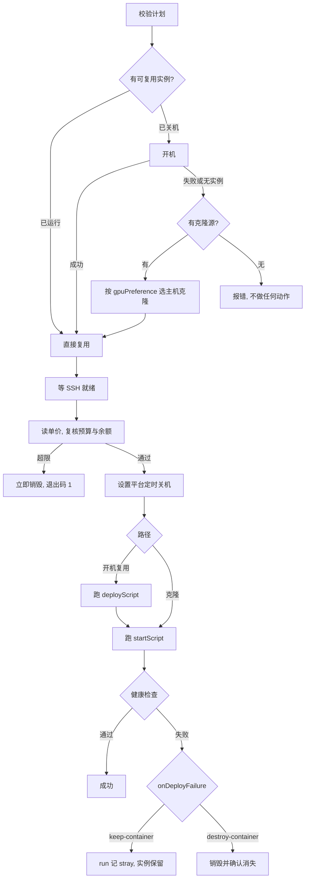

# deploydeck 操作手册

本文供外部项目的人员与 agent 使用。读完本文即可操作 deploydeck，不需要读 deploydeck 源码。

本文只写「怎么用」。命令参数的精确形状、`--json` 字段与退出码逐条说明见
[CLI 命令面](cli.md)。本文是该文档的操作版：先做什么、后做什么、每步判据是什么。

## 1. 这个工具做什么

deploydeck 把一次云端部署收敛成一条链路：

```text
申请计划 → 取实例 → 部署 → 验证 → 结束
```

三件事由它保证：

1. 没有计划不得开机或克隆。计划写明可用时长与预算上限。
2. 部署成功后自动设置平台定时关机。到点平台关停实例，不依赖 deploydeck 进程存活。
3. 每一步留日志与账本。实例销毁后，现场仍在本机。

deploydeck 不构建镜像、不管本地部署、不替代 AutoDL 控制台。

### 1.1 六个名词

| 名词 | 一句话含义 |
|---|---|
| 部署配置（Profile） | 一个场景怎么部署：实例名、算力规格优先级、时长、预算、失败策略、两个脚本 |
| 项目清单（Project） | 一个项目的代码来源、实例内目录、健康检查命令 |
| 计划（Plan） | 一次授权窗口：能用多久、最多花多少 |
| 执行（Run） | 计划下的一次部署动作，含逐步日志 |
| 实例 | AutoDL 控制台里的一台容器实例 |
| 账本 | 一行一个实例生命周期：规格、起止时刻、单价、金额 |

完整术语见 [术语表](../GLOSSARY.md)。

## 2. 外部项目接入：准备五个文件

deploydeck 不认识任何具体项目。接入一个项目只需在配置目录放两个 JSONC 文件，
并在被部署的仓库里放两个脚本。

### 2.1 配置目录

| 目录 | 默认位置 | 谁写 |
|---|---|---|
| 配置目录 | `~/.config/deploydeck` | **人写，机器只读** |
| 状态目录 | `~/.local/state/deploydeck` | 机器写 |

```text
<配置目录>/
├── projects/<projectId>.jsonc    项目清单，一个项目一份
└── profiles/<profileId>.jsonc    部署配置，一个场景一份
```

判据：deploydeck 不会改写配置目录里的文件。状态目录不得放在配置目录内。

### 2.2 项目清单 `projects/<id>.jsonc`

它随被部署的项目走，不进 deploydeck 仓库。

| 字段 | 必填 | 含义 |
|---|---|---|
| `id` | 是 | 项目标识。文件名去掉 `.jsonc` 必须等于它 |
| `repository.url` | 是 | 代码的 git 地址。实例内按它克隆 |
| `repository.branch` | 否 | 默认分支，缺省 `main` |
| `workdir` | 是 | 实例内的项目目录，例如 `/root/my-project` |
| `healthCheck` | 是 | 部署后的验证命令。退出码 0 即通过 |

```jsonc
{
  "id": "my-project",
  "repository": { "url": "git@github.com:owner/my-project.git", "branch": "main" },
  "workdir": "/root/my-project",
  "healthCheck": "curl -fsS http://127.0.0.1:6006/health"
}
```

判据：`healthCheck` 必须能在实例内跑通。服务没有健康端点时，改用该服务确实可用的探活命令，
否则部署会以健康检查失败告终。

### 2.3 部署配置 `profiles/<id>.jsonc`

它规定某个场景怎么部署。开发与生产的差别全部写在这里，引擎不按「开发/生产」分支判断。

| 字段 | 必填 | 含义 |
|---|---|---|
| `id` | 是 | 配置标识。文件名去掉 `.jsonc` 必须等于它 |
| `project` | 是 | 引用项目清单的 `id` |
| `provider` | 否 | 控制面实现，缺省 `autodl`。当前只接入了 `autodl` |
| `instanceNamePattern` | 是 | 实例名。控制台已有同名实例时复用它，没有时用它创建 |
| `gpuPreference` | 是 | 算力规格优先级，左端最高。克隆时按它选主机，不跳档 |
| `regionPreference` | 否 | 地区优先级，空数组表示不限制 |
| `powerOnMode` | 否 | 开机形态：`gpu`（缺省）或 `no-gpu` |
| `cloneDataDisk` | 否 | 克隆时是否一起拷贝数据盘，缺省 `true` |
| `cloneSourceInstanceName` | 否 | 克隆源实例的名字或 ID。走克隆路径时必须有 |
| `ttlMinutes` | 是 | 计划默认可用分钟数 |
| `budgetCapYuan` | 是 | 计划默认预算上限，单位元 |
| `onDeployFailure` | 否 | `keep-container`（缺省值）或 `destroy-container` |
| `requirePinnedCommit` | 是 | 是否强制指定 commit。必填，不给默认值 |
| `deployScript` | 是 | 项目仓库内的部署脚本相对路径 |
| `startScript` | 是 | 项目仓库内的启动脚本相对路径 |

```jsonc
{
  "id": "my-project-dev",
  "project": "my-project",
  "provider": "autodl",
  "instanceNamePattern": "my-project-dev",
  "gpuPreference": ["v-32g-p", "5090-p"],
  "powerOnMode": "no-gpu",
  "cloneSourceInstanceName": "my-project-dev",
  "ttlMinutes": 60,
  "budgetCapYuan": 6,
  "onDeployFailure": "keep-container",
  "requirePinnedCommit": false,
  "deployScript": "scripts/deploy.sh",
  "startScript": "scripts/start.sh"
}
```

`gpuPreference` 的取值可以是 AutoDL 的算力规格 id，也可以是选主机页显示的型号名。
已收录的 id：

| 规格 id | 选主机页显示名 |
|---|---|
| `v-48g` | vGPU-48GB |
| `v-32g-p` | vGPU-32GB |
| `5090-p` | RTX 5090 |
| `pro6000-p` | RTX PRO 6000 |
| `v-48g-350w` | vGPU-48GB-350W |
| `h800` | H800 |
| `4090D` | RTX 4090D |

表外取值原样当作页面型号名匹配。匹配失败时 deploydeck 报错并列出页面可选型号，不猜。

### 2.3.1 `powerOnMode`：开发测试用无卡，需要算力才用有卡

| 取值 | 行为 | 代价 |
|---|---|---|
| `gpu` | 租用算力开机。主机没有空闲 GPU 时开不了机，引擎改走克隆 | 贵 |
| `no-gpu` | 无卡模式开机。不占 GPU，主机没有空闲 GPU 也能开机 | 便宜，几乎可忽略 |

判据：

1. **开发与测试环境写 `no-gpu`。** 无卡模式几乎不花钱，且不会因为主机没卡而失败。
2. **真的需要算力时才写 `gpu`。** 例如要在容器里跑模型。
3. 引擎不会自行降级到无卡模式，也不会从无卡模式升到有卡模式。写什么就做什么。
4. 实例已经以有卡形态运行时，`run` 不会为了走无卡模式去关机重开。它报错要人决定。

老配置不写 `powerOnMode` 时按 `gpu` 处理，行为不变。

`onDeployFailure` 只管容器，不管代码。`requirePinnedCommit` 只管代码，不管容器。两者互不影响。

| 取值 | 部署失败后 |
|---|---|
| `keep-container` | 容器保留，人可进去查现场。期间继续计费，到计划过期时销毁。开发用 |
| `destroy-container` | 立即关机、释放，并确认实例从列表消失。生产用 |

判据：`requirePinnedCommit=true` 时 `run` 必须给 `--commit`，否则拒绝执行且不做任何动作。

### 2.4 被部署仓库里的两个脚本

deploydeck 只认两个脚本。它们的路径相对于项目仓库根。

| 脚本 | 什么时候跑 | 该做什么 |
|---|---|---|
| `deployScript` | **只有开机复用路径跑** | 拉代码、装依赖、构建产物 |
| `startScript` | **两条路径都跑** | 拉起常驻进程，让它开始监听端口 |

判据：克隆出来的实例环境已就绪，只跑 `startScript`。开机复用的实例代码可能过期，先跑 `deployScript`。

两个脚本必须满足：

1. 在实例内可执行。引擎在项目目录里按 `bash <脚本路径>` 调用，
   路径相对于项目仓库根，所以脚本本身不需要可执行位。
2. 成功返回退出码 0，失败返回非 0。引擎只看退出码。
3. 不得交互。没有终端，等待输入会挂到超时。
4. 长驻进程必须由 `startScript` 拉起并脱离当前会话（例如 `pm2`）。`startScript` 本身必须返回。

超时：`deployScript` 1800 秒，`startScript` 600 秒，`healthCheck` 120 秒。

### 2.5 接入检查清单

1. 配置目录里放好 `projects/<id>.jsonc` 与 `profiles/<id>.jsonc`。
2. 被部署仓库里放好两个脚本，并在实例上验证过它们能跑通。
3. 控制台里有一台**已关机**实例，名字等于 `cloneSourceInstanceName`。它是克隆模板。
4. 执行 `deploydeck profile list`，确认配置能被解析。

`profile list` 会一次报完全部配置问题。配置有错时不做任何控制台动作。

## 3. 构建与安装

deploydeck 当前不发 npm 包。从源码构建：

```bash
git clone https://github.com/ZQH123196/deploydeck.git
cd deploydeck
pnpm install
pnpm build
node dist/cli/main.js --help
```

要求 Node.js 22 或更高。

下文命令里的 `deploydeck` 有两种写法，任选其一：

```bash
# 写法一：直接调构建产物
node /path/to/deploydeck/dist/cli/main.js status

# 写法二：起一个别名
alias deploydeck='node /path/to/deploydeck/dist/cli/main.js'
```

## 4. 首次使用

### 4.1 登录控制台

```bash
deploydeck login
```

它会启动一个**专用 Chrome**，打开 AutoDL 控制台，等人登录。登录完成后命令返回。

判据：

1. 专用 Chrome 使用独立 user-data-dir，与日常浏览互不干扰。
2. deploydeck 不填账号密码。登录只由人完成。
3. 默认等待 300 秒，超时退出码 2。可用 `--timeout <秒>` 改。

登录态保存在专用 Chrome 中。需要重新登录时，再跑一次 `deploydeck login`。

### 4.2 环境变量

全部环境变量只在这几处生效。不需要的一律不用配。

| 变量 | 默认值 | 用途 | 哪些命令需要 |
|---|---|---|---|
| `DEPLOYDECK_CONFIG_DIR` | `~/.config/deploydeck` | 配置目录 | 全部 |
| `DEPLOYDECK_STATE_DIR` | `~/.local/state/deploydeck` | 状态目录 | 全部 |
| `DEPLOYDECK_CDP_PORT` | `9222` | 专用 Chrome 的 CDP 端口 | 需要控制台的命令 |
| `DEPLOYDECK_CHROME_LAUNCH_BACKGROUND` | `0` | 后台启动 Chrome（最小化、不抢前台）。只支持 WSL 调 Windows Chrome | 需要控制台的命令 |
| `DEPLOYDECK_CHROME_EXECUTABLE` | 按平台自动查找 | 专用 Chrome 的绝对路径 | 需要控制台的命令 |
| `DEPLOYDECK_BALANCE_WARN_BELOW_YUAN` | 无 | 余额告警阈值，元 | 只有 `guard` |

判据：`DEPLOYDECK_BALANCE_WARN_BELOW_YUAN` 没有默认值。不配置时 `guard` 启动即报错（退出码 2）。

专用 Chrome 的 user-data-dir 与 WSL 下的落点已有正确默认值，一般不用配。
要改可查 [CLI 命令面](cli.md) 的环境变量一览。

### 4.3 确认配置

```bash
deploydeck profile list
```

输出一张表：ID、项目、provider、时长、预算、失败后策略、是否锁定 commit。

## 5. 一次完整部署

五步。每步都先看退出码，退出码为 0 才继续。

### 5.1 创建计划

```bash
deploydeck plan create --profile <profileId>
```

`--ttl <分钟>` 与 `--budget <元>` 覆盖配置里的默认值。

计划决定两件事：这次能用多久、最多花多少。**没有生效计划时 `run` 拒绝开机或克隆。**

判据：计划创建不打开浏览器，只校验配置并落盘。落盘后打印计划 id。

平台定时关机的时刻 = 计划过期时刻减 5 分钟（安全余量）。

### 5.2 执行部署

```bash
deploydeck run --plan <planId>
```

或者按配置自动找生效计划：

```bash
deploydeck run --profile <profileId>
```

| 参数 | 用途 |
|---|---|
| `--plan <planId>` | 直接用这份计划 |
| `--profile <profileId>` | 找该配置的生效计划。恰好一份时用它，多于一份报错，零份失败 |
| `--create-plan` | 允许 `--profile` 在零份生效计划时当场新建一份。显式授权开关 |
| `--commit <sha>` | 部署的代码版本，4-40 位十六进制。`requirePinnedCommit=true` 时必填 |

`--plan` 与 `--profile` 必须且只能给一个。

`run` 的内部顺序：



判据：

1. 先开机，开机失败才克隆。开机是秒级，克隆是分钟级，克隆还消耗每日配额（10 次）。
2. 实例名重复时报错并列出全部同名实例 ID，不猜该用哪一台。
3. 克隆前检查当日剩余次数。次数为 0 时报错，建议改用开机复用。
4. 单价只从控制台读取。与上次观测偏差超过 20% 时停下，不按未知价格继续。
5. 预算或余额不足时**立即销毁实例**，退出码 1。不做「先跑完再说」。
6. 部署成功后实例**继续运行**。`run` 不等同于「部署完就关机」。

`--json` 输出含 `runId`、`mode`（`reuse` 或 `clone`）、`instanceId`、逐步结果与日志路径。

### 5.3 查看状态

```bash
deploydeck status
```

输出：生效计划、绑定实例、实例当前状态、单价、累计花费、账本摘要。

判据：没有生效计划时不打开控制台，省掉一次登录态检查。

### 5.4 收工

```bash
deploydeck teardown <planId>
```

执行顺序：销毁容器 → 确认实例从控制台列表消失 → 写账本 → 计划转 `closed`。

判据：

1. 终态判据是「实例从列表消失」，不是「释放请求返回成功」。
2. 未确认消失时计划转 `ESCALATED`，退出码 2，不自动重试。此时钱可能还在烧，必须人工去控制台确认。
3. 同一实例生命周期只写一行账本。重复执行 `teardown` 不重复记账。

### 5.5 兜底守护

```bash
DEPLOYDECK_BALANCE_WARN_BELOW_YUAN=20 deploydeck guard
```

前台常驻，每 5 分钟一轮，做三件事：

1. 过期的生效计划：销毁绑定实例，确认消失后记账并关闭计划。
2. 超预算的计划：销毁并关闭。
3. 读账户余额，低于阈值时告警。

| 参数 | 含义 |
|---|---|
| `--interval-minutes <n>` | 巡检间隔，默认 5 |
| `--once` | 只巡一轮就退出。人工排查用 |
| `--json` | 只与 `--once` 一起用，输出一轮巡检报告 |

判据：

1. 浏览器连不上时降级为告警，进程不退出，已有实例不受影响。
2. `guard` 的退出码不因 `escalated` 或降级而改变。
3. Phase 2 不做系统级自启动。要常驻，得人自己把它挂在终端或自管的进程里。

## 6. 进容器：交互式终端

部署只是链路的一半。观察进度、处理需要确认的安装、出问题查现场都要进容器。

### 6.1 进入交互式 shell

```bash
deploydeck shell <instanceId>
```

它分配 PTY 并进入远端登录 shell。方向键、`Ctrl-C`、`top` 这类交互工具都能用。
窗口尺寸跟随本地终端，改窗口大小会通知远端。

退出：输入 `exit`，或按 `Ctrl-D`。

判据：

1. 只连**运行中**的实例。已关机时报 `INSTANCE_NOT_RUNNING`，退出码 1。
2. 不自动开机。要连已关机实例，先自己把它开起来。
3. 不校验计划。计划外手工开机的实例照样能连。
4. 必须在真终端里跑。管道、重定向、CI 里没有 tty，报 `INTERACTIVE_TERMINAL_REQUIRED`，退出码 2。

### 6.2 在 PTY 里跑一条命令

```bash
deploydeck shell <instanceId> -- apt-get update
```

它在同一个 PTY 里执行这条命令，然后断开。适合三件事：

1. 需要看进度的长任务。
2. 需要确认的步骤，例如 `apt install`。
3. 在脚本里跑一条命令并拿到退出码。

判据：

1. `--` 之后的全部参数拼成一条命令。命令里的引号、空格原样保留。
2. 远端退出码就是本命令的退出码。
3. 没拿到远端退出码时报 `SHELL_FAILED`，退出码 2。后台任务、连接中断都会走到这里。
4. 这一步不落盘、不进执行记录、不写账本。它的输出直接进你的终端。

### 6.3 终端不改任何状态

| 项 | 终端会话是否改变 |
|---|---|
| 计划状态 | 否 |
| 执行记录 | 否 |
| 账本 | 否 |
| 实例开关机状态 | 否 |

判据：开终端不等于开始计费，关终端不等于结束计费。计费只跟实例是否存在有关。

所以用完终端必须自己处理实例：`teardown` 或等平台定时关机。

### 6.4 安全边界

1. 密码取自控制台 SSH 登录列，只用一次。不落盘、不进日志、不进错误消息。
2. 主机密钥指纹照样校验。首次记录，变化即 `HOST_KEY_CHANGED`，退出码 2。
3. 终端输出直接进你的屏幕，不经 deploydeck 的 stdout 抽象，因此不进 `--json`。

## 7. 命令速查

| 命令 | 作用 | 需要控制台 |
|---|---|---|
| `profile list` | 列出全部部署配置 | 否 |
| `plan create --profile <id>` | 创建计划（授权窗口） | 否 |
| `plan show [planId] [--balance]` | 查看计划。`--balance` 读账户余额 | 带 `--balance` 时需要 |
| `run --plan <id>` / `run --profile <id>` | 执行部署 | 是 |
| `status` | 查看计划、实例、花费、账本 | 有生效计划时需要 |
| `teardown <planId>` | 销毁实例、记账、关闭计划 | 是 |
| `login` | 打开专用 Chrome 等人登录 | 是 |
| `guard [--once]` | 前台常驻守护 | 是 |
| `shell <instanceId>` | 进入交互式终端 | 是 |
| `shell <instanceId> -- <cmd>` | 在 PTY 里跑一条命令 | 是 |
| `plan extend` | 未实现，退出码 2 | — |
| `ledger` | 未实现，退出码 2 | — |

`-v, --version` 打印版本号。未知命令退出码 1，并打印 `参数错误。用 --help 查看全部命令与参数。`

全部命令都支持 `--json`。它既可写在命令前面，也可写在命令后面。

## 8. 机器读者约定

外部项目接 deploydeck 时按这一节写集成代码。

### 8.1 用 `--json`，不看人读输出

```bash
deploydeck status --json
```

判据：

1. `--json` 模式下 stdout **只有一行，是一个 JSON 对象**，没有别的行。
2. 进度、引擎日志、错误信息一律走 stderr。
3. `--json` 模式下 stdout 不出现人读文字。

因此解析 stdin/stdout 时按整行 `JSON.parse` 即可，不需要剥离前缀。

### 8.2 按退出码分叉，不按错误文本分叉

| 退出码 | 含义 | 集成方该做什么 |
|---|---|---|
| 0 | 成功 | 读 stdout 的 JSON，继续下一步 |
| 1 | 业务失败 | 修正输入后重试。例如计划无效、预算不足、脚本失败、健康检查失败 |
| 2 | 需要人工 | **停止自动重试**，转人工。例如未登录、配置非法、克隆超时、实例未确认消失、配额耗尽、命令未实现 |

判据：退出码 1 可由程序自行处理；退出码 2 一律交给人。把退出码 2 当退出码 1 重试会放大问题，
例如实例未确认消失时反复重试只会重复发控制台请求。

参数解析错误（缺必填参数、未知命令）统一映射为退出码 1。

### 8.3 错误码

错误信息在 stderr。需要按错误类型分支时，读 stderr 首行的行首方括号内容。

错误行格式固定为：

```text
[<错误码>] <中文消息>
```

例：

```text
[PLAN_INVALID] 计划不存在：plan-20261126190100-29b7。请先执行 plan create。
```

完整错误码表见 `src/errors.ts` 的 `DeploydeckErrorCode`。常用的几类：

| 错误码 | 退出码 | 含义 |
|---|---|---|
| `PLAN_INVALID` | 1 | 没有生效计划，或计划已过期 |
| `BUDGET_EXCEEDED` | 1 | 超出预算上限 |
| `BALANCE_INSUFFICIENT` | 1 | 账户余额不足 |
| `PINNED_COMMIT_REQUIRED` | 1 | 配置要求锁定 commit，但没给 `--commit` |
| `SCRIPT_FAILED` | 1 | 部署脚本或启动脚本失败 |
| `HEALTH_CHECK_FAILED` | 1 | 健康检查未通过 |
| `LOGIN_REQUIRED` | 2 | 控制台未登录 |
| `CONFIG_INVALID` | 2 | 配置目录里的文件非法 |
| `CLONE_QUOTA_EXHAUSTED` | 2 | 当日克隆次数用尽 |
| `CLONE_TIMEOUT` | 2 | 克隆超时 |
| `INSTANCE_NOT_GONE` | 2 | 实例未确认消失。钱可能还在烧 |
| `BROWSER_CHANNEL_FAILED` / `CHROME_LAUNCH_FAILED` | 1 / 2 | 浏览器通道不可用 / 专用 Chrome 起不来 |
| `NOT_IMPLEMENTED` | 2 | 命令未实现 |
| `INSTANCE_NOT_RUNNING` | 1 | 目标实例不在运行中，SSH 连不上 |
| `INTERACTIVE_TERMINAL_REQUIRED` | 2 | 需要交互式终端，但当前进程没有 tty |
| `SHELL_FAILED` | 2 | 终端会话失败：没拿到远端退出码、通道断开、参数冲突 |

### 8.4 典型集成流程

```bash
set -e

# 1. 确认配置
deploydeck profile list --json

# 2. 开计划
plan_id=$(deploydeck plan create --profile my-project-dev --json | jq -r '.plan.id')

# 3. 部署
deploydeck run --plan "$plan_id" --json

# 4. 查询
deploydeck status --json | jq '.plans[] | { planId, instanceId, spentYuan }'

# 5. 收工
deploydeck teardown "$plan_id" --json
```

判据：第 5 步必须执行。`run` 成功后实例仍在运行并计费，只有 `teardown` 或计划过期才会销毁。

### 8.5 agent 使用的额外约束

1. 不要自动执行 `plan create --ttl` 超过用户声明的总时长。计划就是花钱授权。
2. 不要自动执行 `teardown` 之外的重试。`teardown` 返回退出码 2 时停下，把实例 ID 报给用户。
3. `run` 返回 `stray` 时实例仍在，必须提示用户进容器查现场或立刻 `teardown`。
4. 不要用 `--create-plan` 绕过计划。它是人工授权开关，不是默认行为。
5. 关掉浏览器窗口不影响平台定时关机，但会让 `guard` 与后续命令全部降级。

## 9. 文件落点

### 9.1 状态目录

```text
<状态目录>/
├── plans/<planId>.jsonc          计划
├── prices/<profileId>.jsonc      单价缓存
├── runs/<runId>.jsonc            执行记录：步骤、命令、退出码、耗时
├── runs/<runId>/logs/<stepId>.log 每一步的完整命令输出
├── ledger.jsonl                  账本，只追加
├── ssh-known-hosts.txt           SSH 主机密钥指纹
├── chrome-profile/               专用 Chrome 的登录态
└── locks/<name>.lock             锁文件
```

完整说明见 [状态目录布局](state-layout.md)。

判据：

1. 状态文件只供阅读，不要手工编辑。机器重写时不保留人工注释。
2. 需要改状态时用命令，不用编辑器。
3. 实例销毁后，`runs/<runId>/logs/` 仍在本机，是唯一现场。

### 9.2 执行步骤 id

`runs/<runId>.jsonc` 的 `steps[].stepId` 取值固定：

| stepId | 含义 |
|---|---|
| `instance-select` | 选择复用还是克隆 |
| `power-on` | 开机 |
| `clone-power-off` | 克隆前关闭源实例 |
| `clone-quota` | 检查当日克隆配额 |
| `clone` | 克隆实例 |
| `ssh-ready` | 等 SSH 就绪 |
| `price-quote` | 读单价 |
| `price-drift` | 单价偏差检查 |
| `price-cache` | 写单价缓存 |
| `budget-recheck` | 预算复核 |
| `balance-recheck` | 余额复核 |
| `timed-shutdown` | 设置平台定时关机 |
| `sync-commit` | 切 commit 并回验 HEAD（只在给了 `--commit` 时出现） |
| `deploy-script` | 跑部署脚本（只在开机复用路径出现） |
| `start-script` | 跑启动脚本 |
| `health-check` | 健康检查 |
| `destroy` | 销毁实例 |

## 10. 出问题时

### 10.1 未登录（退出码 2）

```text
请在专用 Chrome 窗口重新登录 AutoDL 控制台，然后重试。
```

处理：

```bash
deploydeck login
```

未登录时 deploydeck 不点任何按钮、不动任何实例。

### 10.2 实例未确认消失（退出码 2，`ESCALATED`）

含义：钱可能还在烧。处理：

1. 打开 AutoDL 控制台，按实例 ID 找到它。
2. 手工关机并释放。
3. 确认列表里不再有它。

deploydeck 不自动重试。计划状态停在 `escalated`，`guard` 只巡检 `active` 计划，不会再处理它。

### 10.3 部署失败但实例保留（`run` 状态 `stray`）

含义：按 `onDeployFailure=keep-container` 保留了容器，人该进去查现场。

处理：

```bash
# 查日志
ls <状态目录>/runs/<runId>/logs/

# 立刻销毁，别等计划过期
deploydeck teardown <planId>
```

判据：`stray` 不是 `failed`。实例仍在列表里并在计费。

### 10.4 锁超时（退出码 2）

上一个进程崩溃后留下了锁文件。处理：

1. 确认没有其它 deploydeck 进程在运行。
2. 删除 `<状态目录>/locks/<name>.lock`。
3. 重试。

### 10.5 控制台页面改版

deploydeck 靠页面结构定位。页面改版会让全部控制面动作失效，报 `CONSOLE_PARSE_FAILED`。

判据：deploydeck 在解析失败时直接报错，不返回空列表冒充结果。遇到这个错误，升级 deploydeck。

### 10.6 检查清单

出问题时按顺序查：

1. 退出码是多少？0 成功、1 业务失败、2 需要人工。
2. stderr 最后一行错误码是什么？
3. 有 `planId` 时跑 `deploydeck plan show <planId>` 看计划是否还生效。
4. 跑 `deploydeck status` 看实例是否还在、在计费。
5. 看 `<状态目录>/runs/<runId>/logs/` 里失败那一步的完整输出。

## 11. 限制与边界

| 限制 | 说明 |
|---|---|
| 平台 | 当前只接入 AutoDL 标准容器实例 |
| 控制面 | 走浏览器自动化。页面改版会导致全部控制面动作失效 |
| 一台实例一个部署单元 | 实例对外只有两个端口 |
| 克隆配额 | 每天 10 次（界面显示） |
| 连续关机释放 | 15 天。超过未处理会被平台回收 |
| `guard` 自启动 | Phase 2 不做，需人自行常驻 |
| `plan extend` / `ledger` | 未实现 |
| 交互式终端 | 只支持本地有 tty 的交互形态；不做跳板机、端口转发、文件传输 |
| 无卡模式 | 只由部署配置显式指定；已有卡运行的实例不会被自动关机重开 |
| 账本对账 | 按量计费不是逐秒结算，余额差额可能小于真实花费。以账本为准 |

判据：deploydeck 不替代 AutoDL 控制台。控制台仍是唯一事实源。
