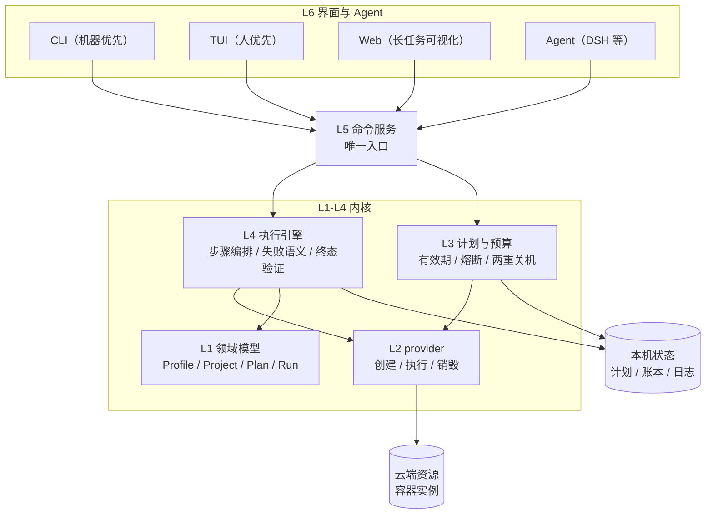

# 架构与分层判据

## 1. 一句话

deploydeck 是一个部署工具箱。它接收“用哪台机器、用多久、花多少”的计划，然后获取实例、打通 SSH、做健康检查、销毁实例。

它不执行使用者的业务脚本。装环境、拉代码、起服务不在它的能力范围内，由使用者经交互终端自己完成。全自动性由 agent 操作这个工具箱来实现，不是这个工具箱本身的性质。

## 2. 分层

## 3. 每层只回答一个问题

| 层 | 它回答的问题 | 输入 | 输出 |
|---|---|---|---|
| L1 领域模型 | 一次部署是什么形状 | 配置与请求 | 校验过的数据结构 |
| L2 provider | 怎么在某类资源上创建、执行、销毁 | 领域对象 | 资源标识与观测结果 |
| L3 计划与预算 | 这次能用多久、能花多少、何时必须关 | Profile 与 Plan | 允许或拒绝，以及关机指令 |
| L4 执行引擎 | 按什么顺序跑哪些步骤，失败怎么办 | Plan | Run 记录与终态 |
| L5 命令服务 | 外部怎么发起动作、怎么读结果 | 命令 | 结果与退出码 |
| L6 界面与 Agent | 人怎么看、Agent 怎么调 | 命令服务 | 文本、JSON、图形 |

## 4. 硬性判据

### 4.1 L1 到 L5 不得引用任何模型或 Agent

判据：内核代码里不出现模型调用。

理由：模型不可用时，人必须还能完成全部部署。这是可用性底线。

### 4.2 人机同入口

TUI、Web、Agent 都必须经过 L5 命令服务。

判据：不存在只有 Agent 能触发、人不能触发的动作。

理由：两条路径会分叉。分叉后行为不一致，无法验收。

### 4.3 CLI 是唯一稳定接口

TUI 与 Web 都调用与 CLI 相同的命令实现。

判据：任何在 TUI 或 Web 里能做的事，都能用一条 CLI 命令做到。

理由：机器可读、可测试、可进入 CI。

### 4.4 层与层之间只通过数据契约对话

判据：上层不读下层的内部字段，下层不 import 上层的模块。

理由：provider 是最需要替换的部分。契约稳定，provider 才能增减。

### 4.5 不执行使用者的脚本

判据：引擎的远端步骤只有健康检查一步。命令文本里不出现 `.sh`、`bash`、`export`。

理由：脚本失败怎么处置、卡住怎么判超时、重复执行如何幂等，这三个问题在引擎层没有通解。把判断责任挪到配置或记录文件，只是换个地方无法回答。装环境、拉代码、起服务由使用者经交互终端自己执行。依据见主仓 ADR-0047。

### 4.6 失败不静默

判据：任何一步失败都终止后续步骤，并写入 Run 记录。

理由：部分成功会让线上状态不可知。

### 4.7 执行引擎的终态与记账时机

一次 Run 的落盘终态有多个值：`created`、`running`、`succeeded`、`failed`、`stray`。
下表只写三种收尾结局。

| 终态 | 判据 | 容器 | 计划 |
|---|---|---|---|
| `succeeded` | 全部步骤退出码 0 | 仍运行，已设平台定时关机 | 保持 `active` |
| `failed` | 失败且容器已确认消失 | 消失 | 保持 `active` |
| `stray` | 实例到手后任一步失败 | 被保留，已停机；停机失败时可能仍在计费 | 停机成功转 `stopped-pending-settlement`；停机失败转 `escalated` |

判据：`stray` 不是 `failed`。`stray` 的报错必须给出进容器查现场的方法；`failed` 的报错必须给出本机现场目录。

步骤分三类，都要留痕。容器消失后只能靠它们还原现场。

| 类型 | 内容 | 日志 |
|---|---|---|
| `console` | 控制台动作：开机、克隆、读单价、设定时关机、销毁 | 引擎写开始与结束记录 |
| `builtin` | 引擎内部判定：复用已运行实例、等 SSH 就绪、单价漂移、预算复核、余额熔断 | 同上 |
| `ssh` | 实例内命令：健康检查（引擎执行的唯一远端命令） | SSH 通道写命令完整输出 |

判据：账本只在实例被销毁并确认消失时写一行。成功路径的实例仍在运行，账等后续 `teardown` 或计划过期时封口；单价未知时不写，因为账本只记已封口的金额。

判据：账本封口一行后，该行金额必须记回 `plan.spentYuan`。账本是事实，计划上的金额是它的投影。
`teardown` 与 `run` 失败收尾都走同一条约定；不投影时预算复核永远从 0 起算。

判据：预算超限、余额不足、单价漂移、计划窗口不足这四类失败与 `onDeployFailure` 无关。它们表示「没有合法窗口继续跑」，一律先停机保留实例再报错；销毁入口仍然只有 `teardown`。

判据：引擎在实例里执行的远端命令只有健康检查一条。它在 `Project.workdir` 里执行，超时 120 秒。

取实例的判定表见《计划、预算与关机》第 3.3 节。

## 5. 术语

| 术语 | 含义 |
|---|---|
| 实例 | provider 上被创建出来的计算资源。AutoDL 里是控制台的一台容器实例。 |
| Profile | 部署配置。它规定规格优先级、使用时长、预算上限、失败策略。 |
| Project | 被部署的项目。它规定代码来源、实例内目录与健康检查命令。 |
| Plan | 一次授权窗口。它给出一段可用时长和预算额度。 |
| Run | 计划下的一次执行。它记录每一步的结果。 |
| 实例 ID | 实例在 provider 里的标识。内部一律用它关联，不用实例名。 |

## 6. 与仓库的关系

deploydeck 是一个独立仓库。

它当前以 git submodule 形式挂在主仓的 `apps/supportProject/deploydeck`，只为了方便开发期同目录修改。

它不进入主仓的 pnpm workspace。它有自己的依赖与锁文件。
