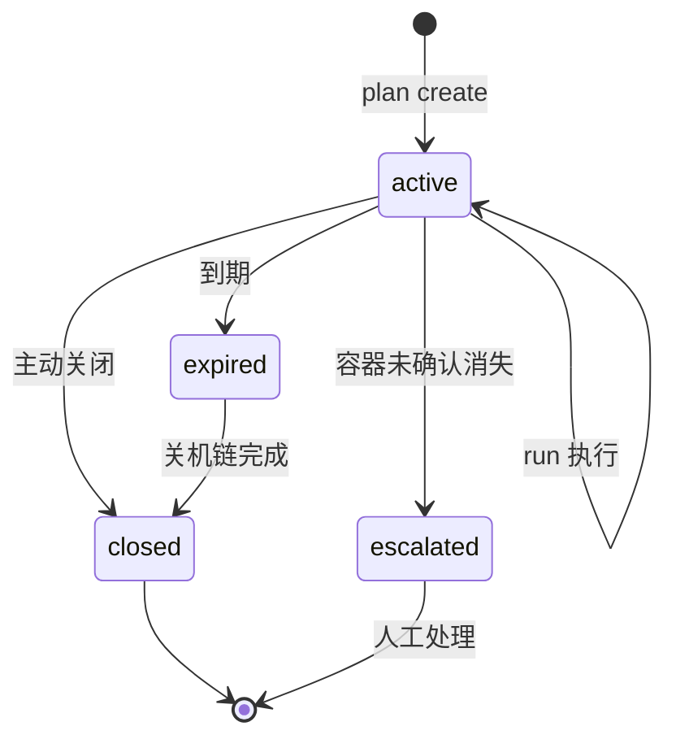

# 计划、预算与关机

> **部分内容已被取代。** 本文假设单价来自 API、平台定时关机由 API 设置。实测表明两者都必须从控制台取得。以 [Phase 2 spec](specs/deploydeck-phase2.md) 为准。
>
> 仍然有效的部分：Profile 字段语义、`onDeployFailure` 与 `requirePinnedCommit` 两条开关互相独立、预算熔断判据、日志保留判据。

## 1. 为什么需要计划

云端 GPU 按小时计费。忘记关机是最贵的错误。

逐次审批管不住它。审批只管“开始”，不管“结束”。

计划管的是“结束”。它事先写明能用多久、能花多少。

## 2. 三个对象

```text
Profile  部署配置。规格优先级、时长、预算、失败策略。
  ↓ 实例化
Plan     一次授权窗口。有明确的过期时刻和预算上限。
  ↓ 执行
Run      计划下的一次动作。记录每一步结果。
```

判据：没有生效的 Plan，执行引擎不得创建容器。

## 3. Profile 字段

| 字段 | 必填 | 含义 |
|---|---|---|
| `id` | 是 | 配置标识 |
| `project` | 是 | 被部署的项目标识 |
| `provider` | 是 | 使用的 provider |
| `gpuPreference` | 是 | 算力规格优先级。左端优先级最高 |
| `regionPreference` | 否 | 地区优先级 |
| `ttlMinutes` | 是 | 本次计划的默认可用分钟数 |
| `budgetCapYuan` | 是 | 本次计划的预算上限，单位元 |
| `onDeployFailure` | 是 | 部署失败后容器怎么办。取值见 3.1 |
| `requirePinnedCommit` | 是 | 是否强制指定 commit。取值见 3.2 |

### 3.1 onDeployFailure

这个字段只管容器。它不管代码。

| 取值 | 部署失败后容器怎么办 |
|---|---|
| `keep-container` | 容器继续运行。到计划过期时刻自动销毁。期间计费。 |
| `destroy-container` | 容器立即销毁。依次执行关机、释放、验证消失。 |

默认值是 `keep-container`。

理由：失败时要能进容器查现场。生产配置显式写 `destroy-container` 即可。

判据：`plan create` 的输出必须打印本次取用的策略。人每次都能看见。

### 3.2 requirePinnedCommit

这个字段只管代码版本。它不影响容器在失败后是否继续运行。

| 取值 | 含义 |
|---|---|
| 是 | 部署前必须给出 commit sha。部署器把容器里的仓库切到该 commit 再构建。 |
| 否 | 允许使用容器里的当前工作区。 |

生产配置取“是”。开发配置取“否”。

理由：线上跑的是哪份代码必须可追溯。

注意：两条开关互相独立。任意组合都合法。

### 3.3 规格选择链

`gpuPreference` 是一个有序列表。引擎按顺序尝试。

```text
for spec of gpuPreference:
    尝试 create(spec)
    成功 → 使用该规格，结束
    失败 → 记录失败原因，试下一档
全部失败 → 整体失败，报出每一档的失败原因
```

判据：不允许跳档，不允许“先建低配再升级”。每次部署只创建一个容器。

理由：先建再升会产生两次计费窗口和一次中间状态。

## 4. Plan 生命周期



| 字段 | 含义 |
|---|---|
| `id` | 计划标识 |
| `profileId` | 来源配置 |
| `createdAt` / `expiresAt` | 授权窗口。一律北京时间 |
| `budgetCapYuan` | 预算上限 |
| `spentYuan` | 已花费。按容器运行时长累加 |
| `state` | 见上图 |
| `resourceId` | 当前占用的容器。可为空 |

判据：`expiresAt` 过期后，任何创建容器的请求一律拒绝。

## 5. 三重关机

三层都必须存在。任何一层单独存在都不够。

| 层 | 触发者 | 动作 |
|---|---|---|
| 平台层 | provider | 创建容器时设置平台定时关机（`timedShutdown` 能力为是时） |
| 计划层 | deploydeck 守护 | 到 `expiresAt` 主动执行销毁链 |
| 兜底层 | deploydeck 守护 | 周期扫描全部容器，发现在运行但没有生效计划的容器，立即销毁 |

判据：第三层不可省略。

理由：deploydeck 进程崩溃时，前两层一起失守。兜底层是此时唯一的保障。

### 5.1 兜底层扫描周期

| 参数 | 建议值 | 说明 |
|---|---|---|
| 扫描间隔 | 5 分钟 | 与“分钟级管理”一致 |
| 单次扫描超时 | 60 秒 | 超时记失败，不阻塞下一轮 |
| 连续失败阈值 | 3 次 | 超过则告警，转人工 |

判据：扫描本身失败不得影响已有容器。

## 6. 预算熔断

实时花费 = 单价 × 运行时长。

```text
spentYuan = Σ over 容器 (pricePerHourYuan × runningHours)
```

判据：`spentYuan` 大于等于 `budgetCapYuan` 时，立即执行销毁链，不询问人。

理由：预算是硬上限，不是参考值。

| 动作 | 条件 |
|---|---|
| 允许创建容器 | `spentYuan + 预估本次花费 < budgetCapYuan` |
| 告警 | 已用达到 80% |
| 熔断关闭 | 已用达到 100% |

预估本次花费 = `pricePerHourYuan × ttlMinutes / 60`。

## 7. 账本

每次容器生命周期写一行账。

| 字段 | 含义 |
|---|---|
| `planId` / `runId` | 归属 |
| `resourceId` | 容器标识 |
| `providerId` | 厂商 |
| `gpuSpecId` | 规格 |
| `startedAt` / `stoppedAt` | 起止时刻 |
| `pricePerHourYuan` | 单价 |
| `amountYuan` | 金额 |

判据：账本只追加，不修改。

理由：事后核对费用时，任何改写都会让账对不上。

## 8. 日志保留

容器可以消失。日志不能消失。

| 内容 | 落点 | 保留 |
|---|---|---|
| 每条命令的完整命令、退出码、耗时 | 本机 Run 目录 | 永久 |
| 命令输出 | 本机 Run 目录，按上限截断并记录原始长度 | 永久 |
| 容器访问信息 | 本机 Run 目录 | 永久 |
| 部署器自身运行日志 | 本机 Run 目录 | 永久 |

判据：部署器在容器销毁前，必须先把本步日志落盘并 flush。

理由：`destroy-container` 策略下，容器消失后现场只剩本机日志。

判据：日志里不得出现凭据明文。凭据只记引用名。
