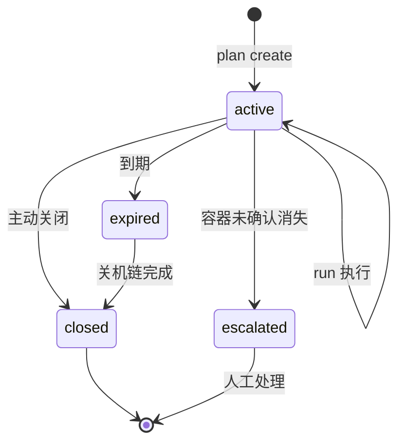

# 计划、预算与关机

> **部分内容已被取代。** 本文假设单价来自 API、平台定时关机由 API 设置。实测表明两者都必须从控制台取得。以 [Phase 2 spec](specs/deploydeck-phase2.md) 为准。
>
> 仍然有效的部分：Profile 字段语义、`onDeployFailure` 开关的判据、预算熔断判据、日志保留判据。

## 1. 为什么需要计划

云端 GPU 按小时计费。忘记关机是最贵的错误。

逐次审批管不住它。审批只管“开始”，不管“结束”。

计划管的是“结束”。它事先写明能用多久、能花多少。

## 2. 三个对象

```text
Profile  部署配置。规格优先级、时长、预算、失败策略。
  ↓ 实例化
Plan     一次授权窗口。有明确的过期时刻和预算上限。
  ↓ 执行
Run      计划下的一次动作。记录每一步结果。
```

判据：没有生效的 Plan，执行引擎不得创建容器。

## 3. Profile 字段

| 字段 | 必填 | 含义 |
|---|---|---|
| `id` | 是 | 配置标识 |
| `project` | 是 | 被部署的项目标识 |
| `provider` | 否 | 控制面实现。默认 `autodl` |
| `instanceNamePattern` | 是 | 实例命名。控制台有同名实例时复用它，没有时用它创建 |
| `gpuPreference` | 是 | 算力规格优先级。左端优先级最高 |
| `regionPreference` | 否 | 地区优先级 |
| `powerOnMode` | 否 | 开机形态。缺省 `gpu` |
| `cloneDataDisk` | 否 | 克隆实例时是否一起拷贝数据盘。默认是 |
| `cloneSourceInstanceName` | 否 | 克隆源实例的名字或 ID。走克隆路径时必填 |
| `ttlMinutes` | 是 | 本次计划的默认可用分钟数 |
| `budgetCapYuan` | 是 | 本次计划的预算上限，单位元 |
| `onDeployFailure` | 否 | 部署失败后容器怎么办。缺省 `keep-container`。取值见 3.1 |

### 3.1 onDeployFailure

这个字段只管容器。它不管代码。

| 取值 | 部署失败后容器怎么办 |
|---|---|
| `keep-container` | 容器保留，实例停机。人可进去查现场。到计划过期时刻由 `guard` 销毁。 |
| `destroy-container` | 当前与 `keep-container` 行为相同：保留容器并停机，不自动销毁。 |

默认值是 `keep-container`。

判据：自动判定失败一律不停机销毁容器，只停机止损。销毁入口只有 `teardown` 命令一条。

理由：销毁不可撤回。失败后要能进容器查现场；自动销毁会把现场一起抹掉。
`destroy-container` 保留取值只为兼容已有配置与字段语义，执行层对它只记一条 warn 日志。

判据：`plan create` 的输出必须打印本次取用的策略。人每次都能看见。

### 3.2 规格选择链

`gpuPreference` 是一个有序列表。克隆时按顺序从选主机页面挑第一档可用规格。

```text
for spec of gpuPreference:
    尝试按该规格选主机
    成功 → 使用该规格，结束
    失败 → 记录失败原因，试下一档
全部失败 → 整体失败，报出每一档的失败原因
```

判据：不允许跳档，不允许“先建低配再升级”。每次取实例只得到一个实例。

理由：先建再升会产生两次计费窗口和一次中间状态。

### 3.3 克隆源实例

控制台的克隆功能以一台**已关机实例**为模板。没有源实例，克隆不出任何东西。

这决定了「取实例」的判定表：

```text
1. 计划已绑定的实例仍在列表里            → 用它
2. 列表里有且只有一台同名实例            → 用它
3. 列表里有多台同名实例                  → 报错，让人先清理
4. 没有同名实例                          → 按 cloneSourceInstanceName 找源实例克隆
   ├ 配置里没写源实例                    → 报错，列出可用的已关机实例供人选
   ├ 找不到源实例                        → 报错，列出可用的已关机实例
   ├ 命中多台源实例                      → 报错，列出 ID
   └ 源实例不是已关机                    → 先关机，再克隆
```

判据：第 3 步与第 4 步只报错与列清单，不替人挑。挑错就是部署到别人的机器上。

判据：克隆出来的实例名继承源实例名，不是 `instanceNamePattern`。下一次执行靠计划里的实例 ID 命中第 1 步。

## 4. Plan 生命周期



| 字段 | 含义 |
|---|---|
| `id` | 计划标识 |
| `profileId` | 来源配置 |
| `createdAt` / `expiresAt` | 授权窗口。一律北京时间 |
| `budgetCapYuan` | 预算上限 |
| `spentYuan` | 已花费。按容器运行时长累加 |
| `state` | 见上图 |
| `instanceId` | 当前占用的实例。可为空 |

判据：`expiresAt` 过期后，任何创建容器的请求一律拒绝。

## 5. 两重关机

已实现两层。本节描述当前行为，不描述计划中的形态。

| 层 | 触发者 | 动作 | 实现状态 |
|---|---|---|---|
| 平台层 | provider | 创建容器时设置平台定时关机（`timedShutdown` 能力为是时） | 已实现 |
| 计划层 | `deploydeck guard` | 到 `expiresAt` 或花到预算上限时主动执行销毁链 | 已实现 |

判据：平台层缺能力时拒绝创建计划（`createPlan` 在 `timedShutdown=false` 时报错）。

理由：平台层由平台自己执行，不依赖本机进程。本机进程崩溃或断电时，平台仍会在定时关机时刻关机。

### 5.1 计划层巡检

| 参数 | 取值 | 说明 |
|---|---|---|
| 巡检间隔 | 5 分钟 | `guard --interval-minutes` 的默认值 |
| 单轮处理范围 | 过期的生效计划、到预算上限的生效计划 | 见 `docs/cli.md` 的 `guard` 一节 |
| 账户余额告警阈值 | 必须显式配置 | `DEPLOYDECK_BALANCE_WARN_BELOW_YUAN`，无默认值 |

浏览器不可用时，守护层降级为告警：记 error 日志、下一轮重试，不退出进程，
不影响已有实例。系统级自启动（pm2 / systemd）属后续阶段。

判据：单轮巡检失败不得影响已有容器，也不得退出进程。

### 5.2 无生效计划的实例需人工处理

`guard` 不扫描实例列表，也不销毁任何不在计划里的实例。

判据：`guard` 只处理「状态为 `active` 的计划」这一种对象。它读的入口是计划文件，
不是控制台实例列表。

后果：以下实例不会被任何自动化流程关机，会一直计费。

1. 进程崩溃或断电前创建、但计划文件已丢失或读不出来的实例。
2. 绑定关系被人手工改掉的实例。
3. 用 `deploydeck power` 开起来的、本来就不属于任何计划的实例。

处理方式：人工核对控制台实例列表，对确认无用的实例执行 `deploydeck power <instanceId> off`。
这一步没有自动化兜底，不要指望 `guard` 替你做。

理由：自动销毁不在计划里的实例要求 `guard` 能区分「本工具创建的」与「别人创建但共用同一账户的」。
控制台列表里没有这个区分字段，猜错就会销毁别人的机器。

## 6. 预算熔断

实时花费 = 单价 × 运行时长。

```text
spentYuan = Σ over 容器 (pricePerHourYuan × runningHours)
```

判据：`spentYuan` 大于等于 `budgetCapYuan` 时，立即执行销毁链，不询问人。

理由：预算是硬上限，不是参考值。

| 动作 | 条件 |
|---|---|
| 允许创建容器 | `spentYuan + 预估本次花费 < budgetCapYuan` |
| 告警 | 已用达到 80% |
| 熔断关闭 | 已用达到 100% |

预估本次花费 = `pricePerHourYuan × ttlMinutes / 60`。

## 7. 账本

每次容器生命周期写一行账。字段以 `LedgerEntrySchema`（`src/state/ledger.ts`）为准：

| 字段 | 含义 |
|---|---|
| `planId` / `runId` | 归属 |
| `instanceId` | 实例标识 |
| `gpuSpec` | 规格 |
| `startedAt` / `stoppedAt` | 起止时刻。`startedAt` 是实例到手时刻，不是执行开始时刻 |
| `unitPriceYuanPerHour` | 单价，元/小时 |
| `amountYuan` | 金额，元 |

判据：账本只追加，不修改。

理由：事后核对费用时，任何改写都会让账对不上。

账本不记录 provider id：一份计划引用一份 Profile，Profile 只属于一个 provider，
事后从 Profile 或执行记录能定位厂商。多写一份就多一处会漂的事实。

### 7.1 金额记回计划

账本是事实，计划上的 `spentYuan` 是它的投影。账本封口一行后，把该行金额加到 `plan.spentYuan`：

| 时机 | 动作 |
|---|---|
| `teardown` 确认实例消失 | 写账本行 → 金额加到计划 → 计划转 `closed` |
| `run` 失败收尾并确认实例消失 | 写账本行 → 金额加到计划 |

判据：先读、加、再写，整段在状态锁内完成；同一实例生命周期只允许一行账，重复执行不重复记。

理由：不投影时预算复核永远从 0 起算，同一份计划跑第二次时第一次烧掉的钱在预算里看不见，
`budgetCapYuan` 就只是个摆设。

## 8. 日志保留

容器可以消失。日志不能消失。

| 内容 | 落点 | 保留 |
|---|---|---|
| 每条命令的完整命令、退出码、耗时 | 本机 Run 目录 | 永久 |
| 命令输出 | 本机 Run 目录，按上限截断并记录原始长度 | 永久 |
| 容器访问信息 | 本机 Run 目录 | 永久 |
| 部署器自身运行日志 | 本机 Run 目录 | 永久 |

判据：部署器在容器销毁前，必须先把本步日志落盘并 flush。

理由：容器消失后（`teardown`、`guard` 销毁），现场只剩本机日志。

判据：日志里不得出现凭据明文。凭据只记引用名。
