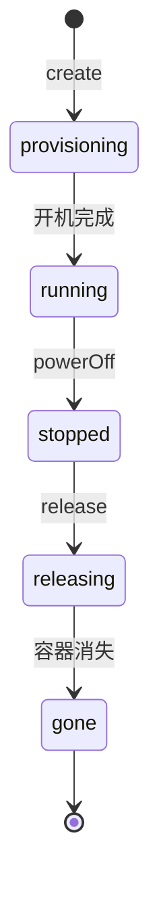

# provider 能力契约

> **部分内容已被取代。** 本文假设控制面走 HTTP API。实测表明 AutoDL 标准容器实例没有管理 API，控制面改为浏览器自动化。以 [Phase 2 spec](specs/deploydeck-phase2.md) 为准。
>
> 仍然有效的部分：能力声明这张表本身，以及「销毁必须验证容器消失」这条判据。

## 1. 目的

provider 屏蔽云厂商差异。上层只按能力询问，不按厂商名分支。

新增一家厂商时，只新增一个 provider 实现。执行引擎、计划、预算三层不改。

## 2. 能力声明

每个 provider 启动时声明自己支持哪些能力。

| 能力 | 含义 | AutoDL | RunPod | local |
|---|---|---|---|---|
| `create` | 能创建全新容器 | 是 | 是 | 否 |
| `powerCycle` | 容器可关机后再开机，数据保留 | 是 | 视存储配置 | 否 |
| `noGpuMode` | 支持无卡降配开机 | 是，但只能人工触发 | 否 | 否 |
| `timedShutdown` | 平台自带定时关机 | 是 | 否 | 否 |
| `accessInfo` | 能查询 SSH 与端口地址 | 是 | 是 | 否 |
| `imageSnapshot` | 能把容器保存成镜像 | 是 | 视实现 | 否 |
| `execOverApi` | 能通过 API 执行命令 | 否，必须走 SSH | 否 | 是 |

判据：能力为否时，上层必须显式拒绝该路径，不得静默降级。

例子：`create` 为否的 provider 不能用于“每次新建”的部署配置。上层在 `plan create` 阶段就报错，不留到运行时。

## 3. 接口

```text
Provider {
  id: string
  capabilities: ProviderCapabilities

  listGpuSpecs(): GpuSpec[]
  create(request: CreateRequest): resourceId
  describe(resourceId): ResourceSnapshot
  exec(resourceId, command, options): ExecResult
  powerOff(resourceId): void
  release(resourceId): void
  assertGone(resourceId): boolean
}
```

### 3.1 CreateRequest

| 字段 | 必填 | 含义 |
|---|---|---|
| `gpuSpecId` | 是 | provider 的算力规格标识 |
| `regionPreference` | 否 | 地区偏好，按顺序尝试 |
| `name` | 是 | 容器备注名。部署器生成，带项目与计划标识 |
| `startCommand` | 否 | 容器开机后自动执行的命令 |

### 3.2 ResourceSnapshot

| 字段 | 含义 |
|---|---|
| `phase` | 容器阶段。取值见 3.3 |
| `accessPoints` | SSH 地址与 HTTP 端口映射 |
| `pricePerHourYuan` | 当前每小时单价。预算核算的唯一来源 |
| `timedShutdownAt` | 平台定时关机时刻。没有该能力时为 null |

### 3.3 容器阶段

| phase | 含义 |
|---|---|
| `provisioning` | 正在创建 |
| `running` | 运行中，计费 |
| `stopped` | 已关机，不计费，容器仍在 |
| `releasing` | 正在释放 |
| `gone` | 容器不存在 |
| `unknown` | 无法判定。不得当作 gone |

判据：`unknown` 不是安全状态。执行引擎遇到 `unknown` 一律转人工。

### 3.4 ExecResult

| 字段 | 含义 |
|---|---|
| `exitCode` | 命令退出码 |
| `stdout` / `stderr` | 输出。落盘时按上限截断，并记录原始长度 |
| `durationMs` | 耗时 |

`exec` 是否走 API 由 `execOverApi` 决定。

AutoDL 的 API 不提供远程执行。AutoDL provider 的 `exec` 一律走 SSH。

## 4. 生命周期与终态验证

### 4.1 创建链



### 4.2 销毁链必须验证

销毁不是一次请求。它是一条链，末态要验证。

```text
powerOff
  → 轮询 describe，直到 phase 不是 running
  → release
  → 轮询 assertGone，直到返回 true
  → 任一环超时 → 状态转 ESCALATED，退出码 2，不再自动重试
```

判据：`powerOff` 返回成功不等于容器已停。`release` 返回成功不等于容器已消失。

理由：计费按容器存在判定。请求成功但容器仍在，钱照样烧。

`ESCALATED` 的含义是“钱可能还在烧，人必须介入”。它不是普通失败。

### 4.3 assertGone 单独成方法

`assertGone` 不复用 `describe` 的实现路径。

理由：`describe` 可能从缓存或单条记录查询。`assertGone` 必须查全量列表。

AutoDL 上对应 `POST /api/v1/dev/instance/pro/list`，按 `uuid` 全表匹配。

## 5. AutoDL provider 映射

官方文档：[容器实例Pro API](https://www.autodl.com/docs/instance_pro_api/)

| 能力 | AutoDL 端点 |
|---|---|
| 创建容器 | `POST /api/v1/dev/instance/pro/create` |
| 查询详情 | `GET /api/v1/dev/instance/pro/snapshot` |
| 查询状态 | `GET /api/v1/dev/instance/pro/status` |
| 查询列表 | `POST /api/v1/dev/instance/pro/list` |
| 开机 | `POST /api/v1/dev/instance/pro/power_on` |
| 关机 | `POST /api/v1/dev/instance/pro/power_off` |
| 释放 | `POST /api/v1/dev/instance/pro/release` |
| 保存镜像 | `POST /api/v1/dev/instance/pro/image/save` |

### 5.1 已知缺口

第一，`power_on` 的 `payload` 只接受 `gpu`。AutoDL 官方文档写明 API 不支持以无卡模式开机。

影响：省钱的无卡安装流程只能人工在控制台操作。

处理：`noGpuMode` 能力标为“仅人工”。部署器识别到该需求时提示人工，不尝试自动化。

第二，AutoDL 没有远程执行 API。`exec` 必须走 SSH。

影响：创建容器后要先拿到 `ssh_command` 与密码，才能部署。

处理：`describe` 返回的 `accessPoints` 必须包含 SSH 地址、端口与凭据引用。

第三，`create` 时不能指定固定地区，只能给偏好列表。

处理：`regionPreference` 按顺序放入 `data_center_list`。

### 5.2 规格标识

`gpuSpecId` 使用 AutoDL 的 `gpu_spec_uuid`。

| 前台名称 | 规格 ID |
|---|---|
| RTX 4090 48G | `v-48g` |
| RTX 5090 32G | `5090-p` |
| PRO6000 96G | `pro6000-p` |
| 4080(S) 32G | `v-32g-p` |

这份表只作参考。真实取值以 `listGpuSpecs()` 运行时返回为准。

## 6. RunPod 预留

RunPod 尚未实现。契约已按它的形状预留。

| RunPod 特点 | 契约落点 |
|---|---|
| 创建与销毁要走 GraphQL 或 REST | `create` / `release` |
| SSH 端口要额外申请 | `accessPoints.ssh` |
| 存储分离，容器销毁后数据仍在 | 与容器生命周期无关，由 Project 步骤负责挂载 |
| 没有平台定时关机 | `timedShutdown` 为否，靠 deploydeck 自己的关机链 |

判据：契约里不出现厂商专有字段。厂商差异一律收敛进 provider 实现。

## 7. local provider

local provider 用于本机调试。

它不创建容器。它把 `create` 视为“准备一个工作目录”，把容器视为本地进程。

| 能力 | 取值 |
|---|---|
| `create` | 否 |
| `execOverApi` | 是 |
| 其余 | 否 |

本机不需要计费，也不需要关机链。销毁动作是停进程。

判据：local provider 不得用于“每次新建容器”的部署配置。上层在计划阶段拒绝。
