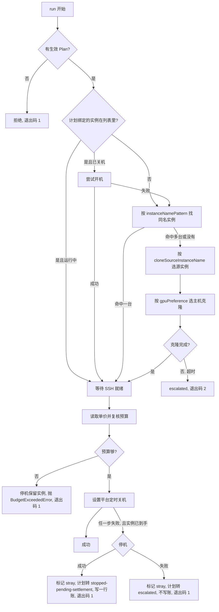

# deploydeck Phase 2 · 设计

> 状态：待评审。评审通过后按 `docs/tickets/` 施工。

## 1. 目标与非目标

### 1.1 目标

第一，用一条命令完成「云端实例从关机到 SSH 可连」。连通性由 `probe` 单独确认。

第二，实例到手后自动设置平台定时关机。到点平台关停实例。

第三，每一步留下可回查的日志与账本。容器消失后，现场仍在本机。

第四，人能做全部动作，AI 也能做全部动作。两者走同一套命令。

### 1.2 非目标

第一，不做镜像构建。镜像在控制台人工保存。

第二，不接管本地部署。本机 pm2 流程保持不变。

第三，不做多用户与权限体系。

第四，不替代 AutoDL 控制台。控制台仍是唯一事实源。

第五，不替使用者跑运行业务的脚本。装环境、拉代码、起服务由使用者经 `shell` 自行执行。

## 2. 运行环境事实

AutoDL 标准容器实例没有管理 API。标准 API 只有两个端点：查余额、切 NFS 挂载。

实例的全部动作都在 Web 控制台完成。因此 deploydeck 的控制面走浏览器自动化。

| 事实 | 值 | 影响 |
|---|---|---|
| 控制面 | Web 控制台 | 必须驱动浏览器 |
| 数据面 | SSH，root 加密码 | 密码取自控制台 SSH 登录列 |
| 对外端口 | 每实例 2 个（6006、6008） | 一台实例只放一个部署单元 |
| 克隆实例 | 控制台功能，无 API，源实例须关机 | 克隆只能走浏览器 |
| 克隆配额 | 每天 10 次（界面显示） | 计划阶段必须检查 |
| 连续关机释放 | 15 天 | 需巡检提醒 |
| 定时关机 | 控制台每行有入口 | 平台层关机可自动化 |
| 余额 | 控制台可读 | 可做熔断 |

## 3. 领域模型

### 3.1 Profile（部署配置）

一份可人工编辑的 JSONC。它规定这个场景怎么取实例。

| 字段 | 必填 | 含义 |
|---|---|---|
| `id` | 是 | 配置标识 |
| `project` | 是 | 引用 Project |
| `provider` | 否 | 控制面实现，缺省 `autodl` |
| `instanceNamePattern` | 是 | 实例命名模板，见 3.5 |
| `gpuPreference` | 是 | 规格优先级。左端最高 |
| `regionPreference` | 否 | 地区优先级 |
| `powerOnMode` | 否 | 开机形态：`gpu`（缺省）或 `no-gpu` |
| `cloneDataDisk` | 否 | 克隆实例时是否一起拷贝数据盘，缺省 `true` |
| `cloneSourceInstanceName` | 否 | 克隆源实例的名字或 ID |
| `ttlMinutes` | 是 | 计划默认时长 |
| `budgetCapYuan` | 是 | 计划预算上限 |
| `onDeployFailure` | 否 | `keep-container`（缺省）或 `destroy-container` |

判据：Profile 只承载实例生命周期与预算。它不承载任何脚本路径、代码版本或环境变量。

### 3.2 Project（项目清单）

| 字段 | 含义 |
|---|---|
| `id` | 项目标识 |

判据：Project 不承载代码来源，也不承载任何要给引擎执行的文本。代码怎么进实例由使用者自己决定；
引擎执行的唯一远端命令由引擎写死（见 `probe`）。`workdir` 与 `healthCheck` 已删除。

### 3.3 Plan（计划）

一次授权窗口。

| 字段 | 含义 |
|---|---|
| `id` | 计划标识 |
| `profileId` | 来源配置 |
| `createdAt` / `expiresAt` | 窗口，北京时间 |
| `budgetCapYuan` | 预算上限 |
| `spentYuan` | 已花费 |
| `state` | `active` / `closed` / `expired` / `escalated` |

### 3.4 Run（一次执行）

| 字段 | 含义 |
|---|---|
| `id` | 执行标识 |
| `planId` | 归属计划 |
| `mode` | `reuse`（开机复用）或 `clone`（克隆新机） |
| `instanceId` | 目标实例 |
| `state` | `created` / `running` / `succeeded` / `failed` / `stray` |
| `steps` | 每步的命令、退出码、耗时、日志路径 |

`stray` 表示执行失败且容器被保留，需要人处理。它不是 `failed`。

### 3.5 实例命名

`instanceNamePattern` 形如 `trans-dev`。

规则一：控制台里已有这个名字的实例，直接复用该实例。内部一律用实例 ID 关联，不用名字关联。

规则二：没有同名实例时，部署器用 `<pattern>` 作为名称创建。

理由：名字给人看。ID 给机器用。同名复用避免每次部署都堆一台新机。

### 3.6 实例与部署单元的关系

一台实例只跑一个部署单元。

理由：实例对外只有两个端口。多单元并存要互相牵连。

## 4. 实例获取流程

判据：自动判定失败只停机止损，不销毁容器。销毁入口只有 `teardown` 命令一条。
`onDeployFailure` 的两个取值当前行为相同（保留容器并停机）。

### 4.1 开机优先，克隆兜底

判据：已有实例先尝试开机。开机失败才克隆。

理由：开机是秒级，克隆是分钟级，克隆还消耗每日配额。

开机失败的定义：控制台提示主机无可用 GPU，或等到超时仍未进入运行中。

### 4.2 克隆时的目标主机

按 Profile 的 `gpuPreference` 顺序，从克隆选主机页面挑第一个可用规格。

判据：不跳档，不先选低配再升降配置。

## 5. 执行范围

引擎不执行任何远端命令，动作序列不随获取方式变化。

| 获取方式 | 引擎执行的动作 |
|---|---|
| `reuse` | 等 SSH 就绪、读单价、平台定时关机 |
| `clone` | 同 `reuse` |

判据：`run` 成功只保证「实例已获取、SSH 端点已就绪、定时关机已设上」。它不保证业务服务可用。

判据：引擎唯一执行的远端命令是 `probe` 的探测命令（`true`，超时 30 秒）。它写死在引擎里，不读任何配置。

判据：装环境、拉代码、起服务不在引擎范围内。使用者经 `shell` 自行执行，并自行判断成败。

## 6. 控制面：浏览器通道

### 6.1 通道形态

专用 Chrome 运行在 Windows 侧。它使用独立 user-data-dir，监听固定 CDP 端口。

WSL 侧通过 `http://127.0.0.1:<port>` 连接。连接已实测可用。

| 项 | 取值 |
|---|---|
| 浏览器 | Windows Chrome |
| 启动方式 | 自 WSL 调 `chrome.exe` |
| profile 目录 | 独立目录，与日常浏览互不干扰 |
| CDP 端口 | 固定，默认 9222 |
| 连接方 | deploydeck，CDP over WebSocket |

### 6.2 页面交互规则

第一，读数据优先用 DOM 查询，不用截图识别。

第二，点击必须用 CDP `Input.dispatchMouseEvent`。实测 JS `.click()` 对 Element Plus 按钮无效。

第三，每个动作前后各截一张图，落进 Run 日志目录。

第四，动作后必须验证结果。判定依据是页面状态变化，不是点击成功。

### 6.3 登录态

判据：页面出现登录入口即视为未登录。

处理：停止动作，打印「请在专用 Chrome 窗口重新登录」，退出码 2。

`deploydeck login` 子命令负责打开窗口并等待登录完成。

## 7. 控制面：控制台动作

### 7.1 读实例列表

页面 `https://www.autodl.com/console/instance/list`。

每行读出：实例 ID、名称、状态、规格、本地磁盘占用、健康状态、付费方式、释放倒计时、SSH 登录信息。

判据：解析失败必须报错，不得返回空列表冒充结果。

### 7.2 开机

行内「开机」。也支持「无卡模式开机」，但无卡模式由人显式触发，不自动使用。

开机后轮询状态，直到 `运行中`，或超时。

### 7.3 克隆实例

流程：「更多」→「克隆实例」→ 勾选需要的数据 → 继续 → 选目标主机 → 确认。

| 项 | 规则 |
|---|---|
| 系统盘 | 平台固定克隆，不可取消 |
| 数据盘 | 默认勾选。Profile 可关闭 |
| 稀疏文件优化 | 默认开启 |
| 源实例 | 必须已关机。未关机先关机 |
| 目标主机 | 按 `gpuPreference` 选择 |

克隆期间新实例状态是 `克隆锁定中`。轮询到该状态消失即完成。

判据：克隆前检查当日剩余次数。次数不足即失败，不尝试。

### 7.4 设置定时关机

行内「设置定时关机」。对话框给出服务器时间、关机时间输入、预计消费、账户余额。

| 项 | 规则 |
|---|---|
| 关机时刻 | 计划 `expiresAt` 减 5 分钟安全余量 |
| 时间基准 | 以对话框显示的服务器时间为准，不用本机时钟 |
| 记录 | 落盘保存服务器时间与关机时刻 |

### 7.5 单价来源

判据：单价只能通过控制台获得。

取得方式：在定时关机对话框填入时长，读「预计消费」，用「预计消费 ÷ 时长」反推单价。

理由：官方 API 的 `payg_price` 单位未标注，且标准实例没有该 API。

### 7.6 关机与释放

| 动作 | 入口 | 判据 |
|---|---|---|
| 关机 | 行内「关机」 | 状态变为 `已关机` |
| 释放 | 「更多」→「释放实例」 | 该实例从列表消失 |

判据：销毁链的终态是「实例从列表消失」，不是「关机请求返回成功」。

销毁链超时未消失，状态转 `ESCALATED`，退出码 2，不自动重试。

## 8. 数据面：SSH

| 项 | 规则 |
|---|---|
| 认证 | root 加密码。密码取自控制台 SSH 登录列 |
| 实现 | Node `ssh2`，Windows 与 Linux 同一条路径 |
| 命令粒度 | 每个 step 一次 SSH 会话 |
| 超时 | 每 step 独立超时，默认 600 秒 |
| 输出 | 落盘完整输出，日志摘要保留尾部 |
| 凭据 | 禁止写入日志。日志只记「已取得密码」 |

判据：主机密钥必须校验。首次连接时记录指纹，指纹变化即失败。

## 9. 计划与预算

### 9.1 计划校验

判据：没有生效 Plan 时，`run` 一律拒绝创建或开机实例。

### 9.2 预算复核

顺序是：开机或克隆成功后 → 读取单价 → 计算本计划预计花费 → 与预算上限比较。

判据：超预算立即停机并保留实例，退出码 1。不做「先跑完再说」，也不销毁实例。

### 9.3 两重关机与余额告警

关机手段只有两重。余额告警不是关机手段，它是单独的一层提示。

| 层 | 手段 | 依赖 | 是否关机 |
|---|---|---|---|
| 平台层 | 设置定时关机 | 浏览器通道 | 是 |
| 计划层 | 守护进程每 5 分钟检查过期计划 | `guard` 进程在跑；自启动属后续阶段 | 是 |
| 余额告警层 | 余额低于阈值记 warn 日志 | 控制台余额 | 否 |

判据：平台层是主要保障。它由平台执行，不依赖本机进程存活。

判据：计划层在浏览器不可用时降级为告警，不静默。记 error 日志、下一轮重试，不退出进程。

判据：余额告警层不改任何实例状态。它只是日志。

判据：没有第三层关机。`guard` 只处理状态为 `active` 的计划，不扫描「运行中但没有生效计划」的实例。
这类实例需要人处理，处理方式是 `deploydeck power <instanceId> --off`。

措辞口径：「两重关机」指行为层数，与 [计划、预算与关机](../plan-and-budget.md) 第 5 节一致。
余额告警单独成层，不计入关机层数。

### 9.4 克隆配额

判据：克隆前读取当日剩余次数。为 0 时给出明确错误，建议改用开机复用路径。

## 10. 执行引擎

第一，引擎不生成任何远端步骤。它只执行控制台动作与内置判定；连通性探测归独立命令 `probe`。
使用者不需要在任何清单里声明步骤，也不允许声明。

第二，失败即停。任一步失败，后续步骤不执行。

第三，每步前后各记录：完整命令、开始时刻、结束时刻、退出码、日志路径。

第四，日志落盘在状态目录的 run 子目录。容器被销毁后，日志仍在本机。

第五，`probe` 执行引擎写死的一条命令，超时 30 秒。退出码非 0 或超时即判不可达。

## 11. 状态与账本

### 11.1 目录分离

| 目录 | 内容 | 谁写 |
|---|---|---|
| 配置目录 | Profile、Project | 人写，机器只读 |
| 状态目录 | Plan、Run、账本、日志、截图 | 机器写 |

判据：机器不得改写配置目录里的文件。

### 11.2 文件格式

全部 JSONC。人可加注释审查。

判据：机器重写状态文件时不再保留人工注释。状态文件只供阅读，人工修改通过命令完成。

### 11.3 并发保护

判据：写状态必须走「临时文件加改名」的原子写，并持有锁文件。

理由：CLI 进程与守护进程会同时写。

### 11.4 账本

每次实例生命周期写一行，只追加，不修改。

字段：计划、执行、实例 ID、规格、起止时刻、单价、金额。

## 12. 退出码

| 退出码 | 含义 |
|---|---|
| 0 | 成功 |
| 1 | 业务失败。预算不足、余额不足、探测失败、计划无效 |
| 2 | 需要人工。未登录、克隆超时、实例未确认消失、配额耗尽 |

## 13. 验收标准

第一，对一台已关机实例执行 `run`，能从开机走到 SSH 就绪且定时关机已设上。

第二，`run` 成功后控制台该实例已设置定时关机，时刻等于计划过期减 5 分钟。

第三，`budgetCapYuan` 设得很小时，`run` 在读到单价后立即停机，退出码 1，实例被保留。

第四，人为把计划过期时刻提前，平台层能自动关机。

第五，实例被销毁后，本机日志目录仍能查到全部命令与输出。

第六，未登录状态下执行 `run`，退出码 2 且不改动任何实例。

第七，`run` 不执行使用者声明的任何步骤：执行记录里没有 `ssh` 类型步骤。

## 14. 待实测项

第一，克隆选主机页面的字段与选择器。控制台进入该页需要点「继续」，本轮未实测。

第二，克隆耗时与配额刷新时刻。

第三，定时关机对话框是否允许设置到当天以外。

第四，SSH 登录列密码的展开方式与是否需要二次确认。

第五，控制台 DOM 选择器稳定性。页面改版会导致全部控制面动作失效。
