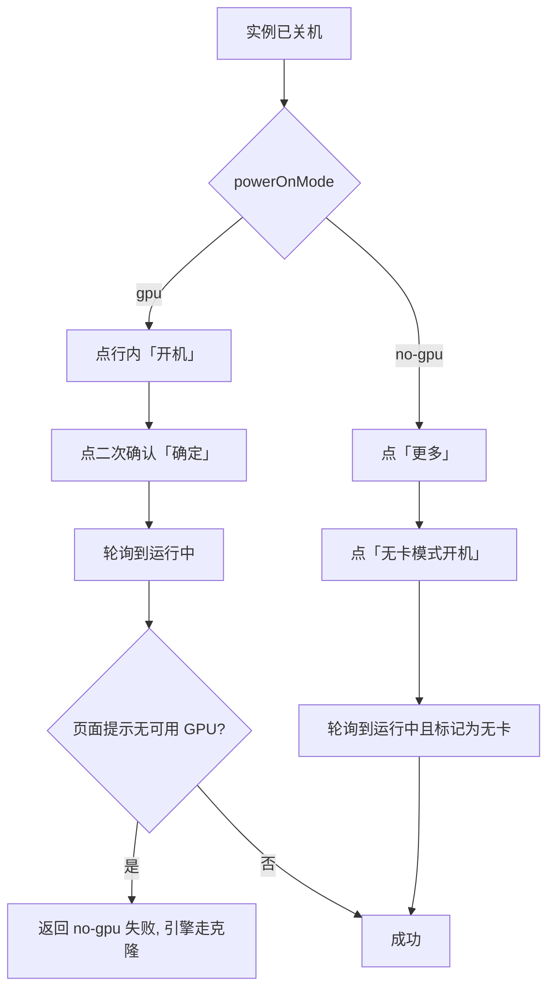
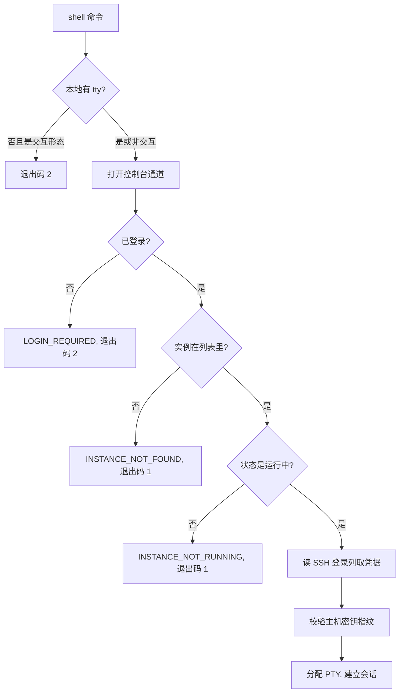

# deploydeck Phase 3 · 终端与无卡开机 · 设计

> 状态：已实现，待真机验证。
> 关联：[Phase 2 spec](deploydeck-phase2.md)、[操作手册](../OPERATIONS.md)、[CLI 命令面](../cli.md)。

## 1. 目标与非目标

### 1.1 目标

第一，新增 `shell` 命令。人能连到运行中实例的交互式终端，也能在 PTY 里跑单条命令。

第二，新增无卡模式开机。开发与测试默认走这条路径。

### 1.2 非目标

第一，不改变既有部署链路。`run` 的步骤顺序、预算复核、定时关机全部不动。

第二，不引入计划校验到 `shell`。终端不创建也不销毁实例。

第三，不做跳板机、端口转发、文件传输。

## 2. 无卡模式开机

### 2.1 为什么需要

开发与测试的主要成本是实例开机。有卡开机依赖主机有空闲 GPU，开不了机就整条链路失败。
无卡模式不占 GPU，单价低，主机没有空闲 GPU 也能开机。

判据：开发与测试环境一律走无卡模式；需要真算力时才走有卡开机。

### 2.2 形态

部署配置（Profile）新增字段 `powerOnMode`。

| 取值 | 含义 |
|---|---|
| `gpu` | 租用算力开机。主机没有空闲 GPU 时失败，失败原因是 `no-gpu` |
| `no-gpu` | 无卡模式开机。不占 GPU，不会因「无可用 GPU」失败 |

缺省 `gpu`。老配置不用改，行为不变。

### 2.3 两条路径的入口不同

判据：

1. 两条路径不互相回退。无卡模式失败不自动改走有卡开机；有卡开机失败不自动改走无卡模式，
   它按 Phase 2 的规则改走克隆。
2. 无卡模式不看「无可用 GPU」提示。它本来就不需要 GPU，那个提示与它无关。
3. 无卡模式成功的判据是「运行中且状态格标记不是 `GPU充足`」。只看「运行中」不够：
   两者状态词相同，差别只在标记。

### 2.4 实例已经以有卡形态运行

判据：不自动关机重开。

理由：关机重开会把一条本来能用的实例按更贵的形态再开一次，还会打断正在跑的服务。

处理：抛需要人工的错误，由人决定接受现状还是先关机。

### 2.5 控制台事实（2026-11-26 真机实测）

| 事实 | 取值 |
|---|---|
| 菜单入口 | 行内「更多」→ 下拉第 1 项 |
| 菜单项文字 | `无卡模式开机` |
| 确认框 | **有**。`.el-message-box`，正文「确认无卡模式开机吗？」 |
| 确认框正文 | `无卡模式配置为:0.5核心CPU，2GB内存，无GPU卡` / `配置费用:￥0.10/时，最低消费￥0.01` |
| 按钮 | 「取消」「确定」 |
| 单价 | **0.10 元/时**，最低消费 0.01 元 |
| 实例规格 | 0.5 核 CPU、2GB 内存、无 GPU |
| 无卡实例状态词 | `开机中`（不是「运行中」） |
| 无卡标记 | 状态格 `.gpuTips` 写 `无卡模式` |
| 有卡标记 | 状态格 `.gpuTips` 写 `GPU充足` |
| 已关机 | `.gpuTips` 元素存在但为空 |

判据：

1. **判定形态看 `.gpuTips` 的标记文字，不看状态词。** 无卡开机中的状态词是「开机中」，
   与有卡开机完全相同。
2. 认得的标记只有 `无卡模式` 与 `GPU充足`。其余取值判为 `null`（未知），不猜。
3. 控制台改文案时，无卡开机会因为等不到标记而超时，而不是静默当成成功。

### 2.6 下拉菜单的可见判据

实测（2026-11-26）：点「更多」后，`.el-dropdown__popper` 在过渡期间
`display: block`、`visibility: visible`，但 `opacity: 0` 且高度为 0。

判据：**不要求几何尺寸。**

1. 可见 = `display !== 'none'`、`visibility !== 'hidden'`、`aria-hidden !== 'true'`。
2. 归属由行内 `.el-dropdown` 的 `aria-describedby` 正面裁决，不靠尺寸。
3. 按尺寸判会把刚点开的菜单判成没打开，轮询到超时。

## 3. 交互式终端

### 3.1 为什么需要

部署之外还有三件事：观察长任务的实时输出、处理需要确认的安装步骤、出问题后进容器查现场。

判据：这三件事都需要 PTY。没有 PTY 时远端不回显、不处理方向键、不显示进度条，
`apt install` 与 `sudo` 的确认提示全部走不通。

### 3.2 两种形态

| 形态 | 命令 | 需要本地 tty | 用途 |
|---|---|---|---|
| 交互 | `shell <instanceId>` | 是 | 人工排查、观察进度、跑需要确认的命令 |
| 非交互 | `shell <instanceId> -- <command>` | 否 | 脚本里跑一条命令，拿到退出码 |

判据：

1. 交互形态要求本地 stdin 是 tty。没有即抛 `INTERACTIVE_TERMINAL_REQUIRED`（退出码 2），
   不静默退化成非交互。
2. 交互形态与 `--json` 互斥。JSON 只有一个对象，交互形态会把远端字节直接写进终端。
3. 非交互形态把命令写进远端登录 shell，再读退出码。命令跑完即断开。

### 3.3 连接前置校验

判据：

1. **不校验计划。** 计划外由人手工开机的实例照样能连。
2. **不读单价、不设定时关机、不写账本。** 终端不改实例生命周期。
3. 主机密钥指纹校验规则与 `run` 完全一致：首次记录，变化即失败。
4. 密码只在内存里。不落盘、不进日志、不进错误消息。

### 3.4 终端状态与部署状态分离

判据：终端会话不改变计划状态、不改变执行记录、不写账本。

理由：账本记的是实例生命周期，终端只是访问它。开终端不等于开始计费，关终端不等于结束计费。

### 3.5 会话终态

| 终态 | 含义 | 退出码 |
|---|---|---|
| 拿到远端退出码 | 会话正常结束 | 远端退出码 |
| 没拿到退出码 | 连接中途断开，或对端没发 exit-status | 2（`SHELL_FAILED`） |

判据：没拿到退出码不得当 0。远端命令是否执行完未知，必须人工核对。

## 4. 验收标准

第一，`profile list` 能显示 `powerOnMode`，三种取值都能解析。

第二，`powerOnMode=no-gpu` 的配置在实例已关机时走「更多」→「无卡模式开机」，不点行内「开机」。

第三，`powerOnMode=no-gpu` 时主机没有空闲 GPU 也不会返回 `no-gpu` 失败。

第四，实例已经有卡运行时不自动关机重开，退出码 2。

第五，`shell <id>` 在真实终端里能进入 shell，方向键与 Ctrl-C 可用。

第六，`shell <id> -- apt-get update` 能看到进度输出，退出码等于远端退出码。

第七，实例已关机时 `shell` 退出码 1，且不建立 SSH 连接。

第八，没有 tty 时 `shell <id>` 退出码 2，不进终端。

## 5. 待实测项

第一，无卡模式开机的二次确认弹窗形态。

第二，无卡模式实例在状态格里的标记文字（`.gpuTips` 的实际取值）。

第三，无卡实例的单价，以及它是否影响定时关机与释放倒计时。

第四，PTY 下 `Ctrl-C`、`Ctrl-Z`、窗口尺寸变化在真实实例上的表现。

第五，非交互形态下命令是否总能拿到退出码（远端登录 shell 可能不转发 `exit-status`）。
